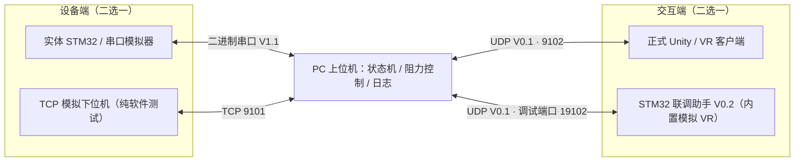

# 沉浸式力反馈单自由度扳手腕系统

本仓库为单自由度力反馈扳手腕系统的 **PC 上位机、控制策略、STM32 串口通信与独立联调工具**代码库。系统通过摆臂主轴角度传感器采集运动状态，由 PC 计算虚拟对手的目标制动阻力并下发至下位机，同时将机械角度与运行状态同步至 VR 场景。

> [!NOTE]
> **核心物理约束与当前阶段**
> - **纯被动制动**：系统采用磁粉制动器，仅提供阻力耗散，不主动驱动机械臂运动。
> - **已完成**：软件控制模型（V0.1–V0.5-C）、正式 VR 软件联合仿真（P3.0）、STM32 串口协议 V1.1 候选及 Windows 联调助手 V0.2 均已完成软件与虚拟串口验证。
> - **待开展**：实体 STM32 接板联调、真实机械参数测量、制动器台架标定、独立电气保护确认、PICO 真机运行及人体实验。

---

## 1. 快速导航

请根据分工选择对应入口，各模块均可先行独立验证，无需等待整机全部到位：

| 分工角色 | 推荐文档与入口 | 独立联调时无需准备 |
| --- | --- | --- |
| **STM32 / 下位机** | [首次交接指南](handoff/stm32_v11/START_HERE.md) · [串口协议 V1.1](docs/stm32-serial-v11.md) · [C 参考源码](firmware_reference/stm32_v11/README.md) · [第 3 节](#3-stm32-下位机对接与联调) | Unity、PICO、MuJoCo |
| **VR / Unity** | [正式 VR 仓库](https://github.com/Ihtbfas/armwrestling-vr) · [UDP V0.1 协议](docs/vr-udp-v01.md) · [第 4 节](#4-vr-端联合仿真) | 实体 STM32、磁粉制动器 |
| **PC 控制与仿真** | [第 5 节](#5-pc-控制策略与仿真研究) · [控制模型收口报告](docs/character-library-v05c.md) | 实体硬件、头显 |
| **机械、电气与整机联调** | [硬件确认清单](handoff/stm32_v11/HARDWARE.md) · [实体联调流程](docs/real-vr-stm32-integration-v01.md) · [联调记录模板](docs/real-integration-record-template.md) | 可按分线流程逐步接入 |

下位机开发人员可直接使用交接包中的独立联调助手完成人物/策略选择、比赛状态控制与串口诊断，**无需安装 Unity 工程，也无需在单片机侧实现人物与对抗策略算法**。

---

## 2. 系统架构与接口约定

### 2.1 通信架构



> 串口与 TCP 为两种可选的下位机接入方式，正式 VR 与联调助手为两种可选的交互客户端，实际运行时按需组合，无需全部同时启动。使用联调助手时，面板会自动托管串口后端进程，不必额外启动 `real.run`。

### 2.2 模块职责与通信协议

| 模块 / 链路 | 核心职责与关键参数 |
| --- | --- |
| **STM32 下位机** | 主轴角度采集、机械零位与方向换算、速度/测力有效性标记、目标阻力执行、本地授权、力矩限幅与命令看门狗等独立保护 |
| **PC 上位机** | 人物属性管理、发力建立与等效疲劳计算、对抗策略调度、目标阻力下发、链路状态监控与实验数据记录 |
| **Unity / VR** | 角色选择、比赛流程控制（等待/进行/暂停/结束）、根据 PC 回传角度驱动虚拟手臂显示 |
| **机械与电气** | 机械行程与配平、磁粉制动器驱动、励磁电流—主轴阻力矩台架标定及独立硬件急停保护 |
| **STM32 ↔ PC 串口** | 支持 USB CDC 或 USART + USB 转串口（USART 默认 `115200 / 8N1`）；协议 V1.1（线上版本 `0x02`、`A5 5A` 帧头、`CRC-16/CCITT-FALSE`）；建议遥测 100 Hz、指令 50 Hz |
| **PC ↔ VR UDP** | 协议 V0.1；本机默认 `127.0.0.1:9102`；VR 每约 200 ms 发送完整状态心跳，PC 以约 50 Hz 回传机械角度与运行模式 |

### 2.3 物理坐标系与数据语义

- **角度与方向**：所有角度、角速度均以**机械摆臂主轴**为基准；机械零位为 `0 rad`，用户向获胜侧下压时角度为**负值**（推进量 `q = -θ` 为正）。
- **指令语义**：PC 下发的是**主轴侧无符号目标阻力矩幅值**（单位 `mN·m`），不包含 PWM、励磁电流或主动驱动方向。
- **通道有效性**：速度或测力通道尚未接入/标定时，下位机须清除对应有效标志位（`VEL_VALID` / `FORCE_VALID`），上位机不会将占位零值视为实测零速或零力。

---

## 3. STM32 下位机对接与联调

> [!CAUTION]
> **首次接板安全前提**
> 首次连接实体 STM32 前，须由下位机与电气负责人员确认**制动器励磁功率已物理隔离、设备运动范围内无人接触**。软件界面的 `STOP` 仅代表零阻力指令，不可替代独立物理急停、硬件限幅或机械制动保护。

### 3.1 C 参考源码接入

完整帧结构、状态位定义、看门狗及重连机制见 [串口 V1.1 协议](docs/stm32-serial-v11.md)。仓库 [`firmware_reference/stm32_v11/`](firmware_reference/stm32_v11/README.md) 提供了无 HAL、无引脚依赖的纯 C99 参考实现，可直接移植至 STM32 工程：

| 文件 | 功能说明 |
| --- | --- |
| [aw_protocol.h](firmware_reference/stm32_v11/aw_protocol.h) / [aw_protocol.c](firmware_reference/stm32_v11/aw_protocol.c) | 字节序编解码、软件 CRC-16/CCITT-FALSE 与流式帧解析 |
| [aw_session.h](firmware_reference/stm32_v11/aw_session.h) / [aw_session.c](firmware_reference/stm32_v11/aw_session.c) | 会话管理、`STOP/ENABLE` 门控、本地授权与命令看门狗参考状态机 |
| [golden_vectors.txt](firmware_reference/stm32_v11/golden_vectors.txt) | Python 与 C 共用的 6 条黄金测试报文 |
| [test_aw_protocol.c](firmware_reference/stm32_v11/test_aw_protocol.c) | PC 端主机编译单元测试 |

接入时仅需将实际串口字节流、MCU 毫秒时钟、传感器数据、本地保护信号及标定后的执行映射对接到相应接口，详细步骤见 [C 参考接入说明](firmware_reference/stm32_v11/README.md)。

### 3.2 启动 Windows 联调助手 V0.2

运行联调助手仅需 **Python 3.10+（含 Tcl/Tk）** 与 **pyserial**，无需安装 MuJoCo 依赖（`requirements.txt`）。在项目根目录或交接包解压目录的 PowerShell 中执行：

```powershell
# 首次使用创建虚拟环境（已有 .venv 时可跳过第一行）
python -m venv .venv
.\.venv\Scripts\python.exe -m pip install pyserial
.\start-stm32-debug.cmd
```

也可直接双击 `start-stm32-debug.cmd`（脚本会自动检测 Python 版本、Tkinter 与 pyserial 环境并给出缺失提示），或使用命令 `python -m tools.stm32_debug` 启动。


联调助手提供两种工作模式：
- **串口检查 · 仅 STOP（默认）**：用于首次接板验证握手、零目标确认、原始收发诊断与遥测监控，后端强制仅发送 `STOP/0`。
- **模拟 VR 比赛**：内置模拟 VR 客户端（占用调试端口 `19102`），支持独立切换人物与策略、操作比赛启停并实时查看 5 Hz 角度/阻力趋势图。

### 3.3 首次接板验证与快速排查

在确认励磁功率已物理隔离后，建议按以下顺序完成首轮通信验收：

1. **建立连接**：运行板端固件并启动联调助手，选择对应 COM 口，保持默认的 **仅 STOP** 模式点击连接（USART 默认 `115200 / 8N1`）。
2. **核对握手与 STOP 确认**：确认 RX/TX 计数正常、合法帧增长、PC 与板端会话编号一致，且面板显示 `SESSION_ACK` 匹配与 `STOP/0` 已确认（此时未授权或角度未标定不影响通信验收）。
3. **检查采样与角度**：确认 MCU 采样时间戳持续递增；角度有效后核对机械零位、正负方向及弧度换算，未接入的速度与测力通道应保持有效位清零。
4. **验证复位恢复与留档**：保持串口打开状态下重启 STM32，确认 PC 自动重新握手并再次确认 `STOP`，且不自动恢复非零阻力；勾选**记录逐帧实验日志**并导出本轮 ZIP 留存。

常见异常排查对照：

| 面板现象 | 优先检查项 |
| --- | --- |
| 串口无法打开 | COM 端口号、USB 驱动、是否被串口助手或其他程序占用 |
| 串口已打开，但 RX 为 0 | 固件是否开始发送遥测、TX/RX 接线与电平、端口配对是否正确 |
| RX 持续增长，合法帧为 0 | 波特率设置、协议版本 `0x02`、帧头 `A5 5A`、载荷长度或 CRC-16；可复制面板 Hex 核对 |
| 收到诊断遥测，握手未完成 | 板端是否收到 `SESSION_OPEN` 并回传相同编号的 `SESSION_ACK` |
| STOP 未确认或回报目标非零 | 下位机命令解析、ACK 序号更新及 `STOP` 清零逻辑 |
| STOP 已确认，但未获本地许可 | 检查本地授权逻辑、角度有效性及硬件保护位（串口通信本身已正常） |

完整界面功能说明见 [联调助手 V0.2 文档](docs/stm32-debug-panel-v02.md)，硬件对接前需双方逐项核对 [硬件确认清单](handoff/stm32_v11/HARDWARE.md)。

### 3.4 模拟比赛、虚拟串口复验与离线分析

- **无 Unity 模拟比赛**：在软件模拟或励磁功率已物理隔离的前提下，断开当前连接，切换至 **模拟 VR 比赛** 并选定人物与策略后重新连接。待会话、STOP 确认、有效角度及本地授权全部满足后即可点击开始（支持 `F8` 暂停、继续、结束与再来一局；更换策略需断开重连）。面板默认在窗口失去焦点时自动暂停，支持独立开启窗口置顶；仅在软件仿真或无励磁调试时可显式勾选后台调试。
- **无实板虚拟串口复验**：在已配置好的虚拟 COM 对（以下以 `COM2 ↔ COM1` 为例）上，可运行串口模拟器配合联调助手完整复验 V1.1 协议（Ubuntu 环境可参考 [Linux PTY 说明](docs/serial-pty-demo.md)）：

```powershell
# 通信与仅 STOP 检查（面板连接配对的 COM1）
.\.venv\Scripts\python.exe -m sim.mock_stm32_serial --port COM2

# 模拟已授权比赛（--demo-arm 仅用于软件模拟器，非实板指令）
.\.venv\Scripts\python.exe -m sim.mock_stm32_serial --port COM2 --demo-arm
```

- **逐帧实验日志与离线导出**：如需精确分析采样时序与指令响应，在连接前勾选**记录逐帧实验日志**，实验结束后先断开再点击**保存本轮日志…**导出 ZIP，随后运行离线分析工具生成 CSV 与统计摘要：

```powershell
.\.venv\Scripts\python.exe -m tools.plot_experiment ".\本轮日志.zip" --out-dir ".\analysis"
```

---

## 4. VR 端联合仿真

正式 VR 工程（人物模型、场景、握姿 IK 与头显适配）维护在独立仓库 [armwrestling-vr](https://github.com/Ihtbfas/armwrestling-vr)。VR 联调可直接使用本仓库的 TCP 模拟下位机，无需实体板卡、虚拟串口、MuJoCo 或头显。

### 4.1 快速启动

在本仓库根目录打开两个 PowerShell 窗口分别运行 PC 桥接与软件模拟下位机：

```powershell
# 窗口一：PC 上位机（监听 TCP 9101 与 UDP 9102）
.\.venv\Scripts\python.exe -m common.bridge --log-file "$env:TEMP\arm-pc.jsonl"

# 窗口二：软件模拟下位机（支持键盘手动施力）
.\.venv\Scripts\python.exe -m sim.mock_stm32 --manual --torque 0.6
```

随后在正式 VR 工程中打开 `Assets/Scenes/ArmWrestlingMain.unity`，进入 Play 后选择**改用网络数据**连接 `127.0.0.1:9102` 即可测试选角与完整比赛流程：
- **手动输入**：在模拟器窗口按 `1`（下压）、`2`（回推）、`0`（松手）、`R`（软件回零），按键切换持续模拟施力状态。
- **可重复自动化输入**：可使用 `--sequence down:2,back:1,release:0.5` 或 `--input-file <路径>` 替代 `--manual`；省略输入参数时默认周期施力。
- **无 Unity 快速自检**：可另开终端运行 `.\.venv\Scripts\python.exe -m sim.mock_vr --character-id person_02 --demo-states` 进行命令行 UDP 测试。

更多细节见 [PC 桥接说明](docs/pc-bridge.md)、[P3.0 联合仿真报告](https://github.com/Ihtbfas/armwrestling-vr/blob/129c989035b7657af526f9eec9bfe6eebea50e56/docs/P3-0-pc-integration.md) 及参考测试工程 [Unity 测试说明](docs/windows-unity-udp-test.md)。

### 4.2 UDP V0.1 接口要点

VR 端使用同一个 UDP Socket 每约 **200 ms** 发送一次完整 UTF-8 JSON 状态心跳（状态未变时也须持续发送），PC 端以约 **50 Hz** 回传机械角度与控制状态；双方各自维护递增序号 `seq`。完整字段与超时规则见 [UDP V0.1 协议](docs/vr-udp-v01.md)。

```json
// VR → PC（准备阶段示例）
{"v":1,"type":"vr_update","seq":0,"character_id":"person_02","match_state":"waiting"}

// PC → VR（比赛运行中示例）
{"v":1,"type":"status","seq":20,"angle_rad":-0.4,"mode":"enabled","reason":"running"}
```

- **状态流转**：准备与倒计时发送 `waiting`，开赛后发送 `running`，暂停与结束分别发送 `paused`、`finished`。
- **角度与模式**：`angle_rad` 为 `null` 表示机械数据无效，客户端应保留上一有效姿态并提示异常，不可将其当作零位；`mode="enabled"` 仅表示 PC 正在计算控制目标，不代表下位机已解除硬件保护。
- **人物与并发**：联网人物 ID 为 `demo`、`person_01`、`person_02`、`person_03`；对抗策略在 PC 侧配置，不新增 UDP 字段。请勿同时启动两个 VR 客户端竞争同一 PC 入口。跨机/头显局域网配置见 [实体联调流程](docs/real-vr-stm32-integration-v01.md)。

---

## 5. PC 控制策略与仿真研究

PC 公共控制层由 `real.run`、TCP 桥接与联调助手共享，核心计算链路为：

```text
主轴角度 → 阻力生效区映射 → 策略系数调制 → 等效疲劳衰减 → 非对称发力建立 → 无符号目标阻力幅值
```

| 控制模块 | 说明与参考文档 |
| --- | --- |
| **人物基础参数** | [V0.1](docs/character-library-v01.md)：`demo` 基线及 3 个虚构演示人物的刚度与阻力上限 |
| **发力建立动态** | [V0.2](docs/character-library-v02.md)：阻力增大时按人物时间常数缓升，下降与停止立即响应 |
| **等效疲劳与恢复** | [V0.3](docs/character-library-v03.md)：高负载疲劳衰减、暂停恢复与新回合清零机制 |
| **独立对抗策略** | [V0.4](docs/character-library-v04.md)：均衡 `balanced`、防守 `defensive`、节奏 `rhythmic` |
| **阻力区 / 方向 / 延迟实验** | [V0.5-A 阻力区域](docs/character-library-v05a.md) · [V0.5-B 回推减阻](docs/character-library-v05b.md) · [V0.5-C 滑行与反应延迟](docs/character-library-v05c.md) |

- **当前默认与候选配置**：默认及真实串口路径固定采用 `legacy + symmetric + 0 ms`（原自由区边界 `q = 0.25 rad`，对应机械角约 `−14.3°`）。下一阶段优先验证的软件候选为小自由区 `narrow + symmetric + 0 ms`；回推减阻 `relief` 与反应延迟（`0–200 ms`）仅保留在 TCP 软件仿真中作为实验对照。现有角色参数均为演示设定，不作为人体测量数据或实机安全限值。

在 TCP 软件仿真中可组合实验参数（双终端运行，配合 VR 或 `sim.mock_vr` 选择非 `demo` 人物）：

```powershell
.\.venv\Scripts\python.exe -m common.bridge --strategy rhythmic --resistance-profile narrow
.\.venv\Scripts\python.exe -m sim.mock_stm32 --torque 0.09 --sequence release:1.2,down:0.66,release:1.2,back:0.22,release:1.72
```

- **MuJoCo 独立机械仿真（可选）**：仅用于前期机械布局与被动控制手感研究，不参与上述通信联调。需要时单独安装依赖并运行：

```powershell
.\.venv\Scripts\python.exe -m pip install -r requirements.txt
.\.venv\Scripts\python.exe -m sim.run
```

机械布局演变、理想配平假设与轨迹分析见 [轨迹适配分析](docs/trajectory-fit.md) 与 [机械仿真归档](docs/project-history-20261115.md)。

---

## 6. 整机合并联调（实体 STM32 + 正式 VR）

在分别完成**第 3 节的实体串口验收**与**第 4 节的 VR 软件联调**，并由机械、电气与下位机组共同确认独立硬件保护、有效行程及制动器台架标定后，再进入整机联调：

1. 关闭所有模拟器、`common.bridge` 及联调助手，释放对应 COM 端口与 UDP `9102` 端口。
2. 首次命令行接板仍在励磁功率物理隔离条件下使用 `--monitor-only` 验证：

```powershell
# COM9 仅为示例，请替换为实际设备端口
.\.venv\Scripts\python.exe -m real.run --port COM9 --vr-port 19102 --monitor-only --log-file pc.jsonl --experiment-log experiment.jsonl
```

3. 硬件保护与台架标定确认后，使用正式入口启动 PC 上位机并连接正式 VR（默认监听 UDP `9102`）：

```powershell
.\.venv\Scripts\python.exe -m real.run --port COM9
```

完整验收步骤与记录规范见 [实体联调流程](docs/real-vr-stm32-integration-v01.md) 与 [联调记录模板](docs/real-integration-record-template.md)。

---

## 7. 仓库目录与验证状态

```text
armwrestling/
├── common/                 核心控制模型、人物策略、协议编解码与状态机
├── real/                   真实串口后端（real.run）与后台实验日志
├── sim/                    TCP / 串口模拟下位机、模拟 VR 与 MuJoCo 仿真
├── tools/                  STM32 联调助手 V0.2、趋势绘图与离线日志分析
├── firmware_reference/
│   └── stm32_v11/          STM32 C99 参考源码、黄金测试报文与主机单测
├── handoff/stm32_v11/      下位机首次交接指南、硬件确认清单与日志示例
├── tests/                  Windows 串口检查、角色模型对比与 Unity 参考客户端
├── docs/                   通信协议、操作手册、图表与各阶段验收记录
├── start-stm32-debug.cmd   Windows 联调助手一键启动脚本
└── TASKS.md                阶段进度与待办事项
```

### 各阶段验证一览

| 阶段 / 模块 | 验证状态与覆盖范围 | 详细记录 |
| --- | --- | --- |
| **P3.0 正式 VR 联合仿真** | 已完成：正式 Unity Editor + TCP 模拟下位机，覆盖选角、比赛状态与异常恢复 | [P3.0 联调报告](https://github.com/Ihtbfas/armwrestling-vr/blob/129c989035b7657af526f9eec9bfe6eebea50e56/docs/P3-0-pc-integration.md) |
| **V0.5-C 软件控制模型** | 已完成：人物参数、发力建立、疲劳、对抗策略、阻力区与延迟对照 | [V0.5-C 收口报告](docs/character-library-v05c.md) |
| **串口协议 V1.1** | 软件已完成：Windows 虚拟 COM、复位重连、采样与 ACK 监控、Python/C 黄金报文 | [V1.1 验收记录](docs/stm32-serial-v11-windows.md) |
| **联调助手 V0.2** | 软件已完成：Tkinter 界面、原始收发诊断、STOP 零目标门控、趋势图与日志导出 | [V0.2 验收与截图](docs/stm32-debug-panel-v02-windows.md) |
| **实体 STM32 / 台架 / PICO** | 待执行：需实板固件、传感器标定、独立电气保护及真机环境 | [TASKS](TASKS.md) · [硬件确认清单](handoff/stm32_v11/HARDWARE.md) |

> 串口协议 V1.1 当前为首次对接候选版本，待下位机组完成实板确认后正式冻结。历史文档 [串口 V1 草案](docs/stm32-serial-v1.md) 与 [早期终端/Unity 验证记录](docs/windows-serial-operator-guide.md) 仅作归档参考，不作为新版固件开发依据。
