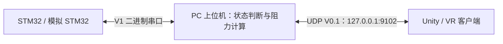

# 沉浸式力反馈单自由度扳手腕系统

本仓库负责 PC 上位机、阻力控制策略和通信测试。PC 接收机械臂的角度、角速度及设备状态，计算目标制动阻力，再把机械角度和运行状态发给 Unity/VR。制动只阻碍运动，不主动驱动机械臂。

VR 同学负责自己的场景、人物动作和比赛交互，按 [UDP V0.1 协议](docs/vr-udp-v01.md) 与 PC 通信。`tests/unity/` 是我们自测用的参考客户端，可以选用，也可以自行实现。

第一次接手，先看下面的框架，再按“交接通信测试”运行。只测 VR ↔ PC 时不需要头显、STM32、虚拟串口或 MuJoCo。

P3.0 使用 [正式 VR 工程](https://github.com/Ihtbfas/armwrestling-vr)和本仓库的模拟下位机完成软件联合仿真。实体 STM32 的独立验收见 [首次接板流程](docs/real-vr-stm32-integration-v01.md)。V0.4 可用 PC 启动参数 `--strategy balanced|defensive|rhythmic`，默认均衡。启动方式、策略和对比数据见 [V0.4 策略说明](docs/character-library-v04.md)。

V0.5-A 的 TCP 软件模拟入口可用 `--resistance-profile legacy|narrow|start-resistance` 比较阻力生效区域，默认沿用原自由区。[实验说明与曲线](docs/character-library-v05a.md)

## 项目框架与分工



| 部分 | 负责什么 | 主要入口或约定 |
|---|---|---|
| PC 上位机 | 接收机械状态、判断比赛与通信状态、计算阻力、回传角度 | 串口入口 `real.run`；TCP 模拟入口 `common.bridge` |
| STM32 | 采集角度与速度、执行制动指令、处理本地使能和故障保护 | [串口 V1 草案](docs/stm32-serial-v1.md)，需与下位机组确认并实现 |
| Unity/VR | 发送角色编号和比赛状态，接收机械角度驱动自己的模型 | [UDP V0.1](docs/vr-udp-v01.md)，同一个 UDP socket 收发 |
| 测试程序 | 代替暂未接入的设备，检查通信和状态变化 | `sim/` 的模拟设备；`tests/` 的联调工具 |

```text
armwrestling/
├── common/
│   ├── control.py          公共阻力算法
│   ├── characters.py       demo 基线和三个示例人物的资料、演示参数
│   ├── strength_response.py  人物阻力缓升、下降与复位
│   ├── fatigue.py          V0.3 等效疲劳与恢复（演示模型）
│   ├── state.py            比赛状态、数据有效性和超时处理
│   ├── serial_protocol.py  STM32 V1 二进制帧编解码
│   ├── protocol.py         UDP JSON 与旧 TCP JSON 校验
│   ├── console.py          中文终端显示与 JSON 日志
│   └── bridge.py           PC 的 TCP 模拟 + UDP 入口
├── real/
│   ├── run.py              PC 的串口 V1 + UDP 入口
│   └── stm32_link.py       串口读写、会话握手和遥测解析
├── sim/
│   ├── mock_stm32.py       TCP 模拟下位机，供快速测试 UDP
│   ├── mock_stm32_serial.py  V1 模拟下位机，支持 Windows COM / Linux PTY
│   ├── mock_vr.py          Python UDP 测试客户端
│   └── run.py / arm.xml    独立的 MuJoCo 力学仿真
├── tests/
│   ├── unity/             Unity 测试客户端、摆臂和编辑器联调工具
│   └── serial/            实际 COM 端口对的协议检查
└── docs/                  协议、操作说明和测试记录
```

`common/bridge.py` 和 `real/run.py` 是两种 PC 启动方式，运行时选一个。两者都会占用 UDP 9102，不能同时启动。PC 正式程序不引用 `tests/unity/`。

## 交接通信测试：先跑通 VR ↔ PC

使用正式主场景联调时，在 PC 仓库根目录分别打开两个 PowerShell 窗口：

```powershell
# 窗口一，保持 PC 状态日志
.\.venv\Scripts\python.exe -m common.bridge --log-file "$env:TEMP\arm-p3-pc.jsonl"
# 窗口二，键盘控制模拟用户施力
.\.venv\Scripts\python.exe -m sim.mock_stm32 --manual --torque 0.6 --log-file "$env:TEMP\arm-p3-sim.jsonl"
```

在 VR 工程打开 `Assets/Scenes/ArmWrestlingMain.unity`，进入 Play 后选择“改用网络数据”，连接 `127.0.0.1:9102`。选择人物并开始倒计时。模拟器窗口使用 **1 下压、2 回推、0 松手、R 软件回零**，按键切换持续输入，无需长按。启动时零施力。建议在倒计时前按 R，将模拟关节保持在零位，开赛后再按 1 或 2。松手后的运动由模拟惯量和制动决定。

重复试验可用 `--sequence down:2,back:1,release:0.5` 替代 `--manual`。序列从首条有效 ENABLE 开始，动作时长按 20 ms 仿真步计，播完松手。自动化也可用 `--input-file 路径`，写入 UTF-8 单个动作 `down`、`back`、`release` 或 `reset`，关节在 `reset` 期间保持零位。省略这三个选项时沿用原周期施力。 `--torque` 设置模拟用户力矩幅值，默认 0.15 N·m，范围 0–0.8 N·m。制动仍由 PC 计算。

固定遥测的阻力/疲劳对照和相同用户施力的闭环轨迹见 [P3.0 PC 侧试验](docs/test-results/2026-11-25-p3-pc-input.md)。

### 参考测试客户端路线

这条路线适合 VR 同学拿到仓库后先确认自己的 UDP 客户端能用。模拟 STM32 通过 TCP 提供机械状态，PC 仍然执行现有控制计算；这一步只验证 UDP，不算串口 V1 验证。

### 1. 准备 Python 环境

需要 Python 3.10+ 和 Git。Windows PowerShell 首次下载时执行：

```powershell
git clone https://github.com/Ihtbfas/armwrestling.git
cd armwrestling
python --version
python -m venv .venv
```

已有仓库就进入自己的仓库根目录，按需执行 `git pull --ff-only origin main`。下面所有终端都在仓库根目录运行；命令里的 `python` 如果不可用，可按本机安装情况改为 `py -3`。

这条 TCP + UDP 路线只用 Python 标准库，不需要安装 `requirements.txt`。该文件是 MuJoCo 仿真的依赖。

### 2. 启动 PC 和模拟下位机

打开两个 PowerShell 窗口，分别运行：

```powershell
# 窗口一：PC 上位机，监听 TCP 9101 和 UDP 9102
.\.venv\Scripts\python.exe -m common.bridge
```

```powershell
# 窗口二：模拟 STM32，产生角度并接收 PC 制动指令
.\.venv\Scripts\python.exe -m sim.mock_stm32
```

此时 PC 提示“尚未收到 Unity 比赛状态”是正常的，下一步启动客户端即可。终端交互模式默认显示中文面板，Ctrl+C 退出。

### 3. 启动要交接的 Unity 客户端

VR 同学可以直接运行自己的客户端；用本仓库的测试摆臂时：

1. 在 Unity 中创建普通 3D 测试工程。本次测试版本是 `2022.3.62f3c1`，无需安装 XR 包。
2. 把 `tests/unity/` 中的两个 C# 文件复制到工程的 `Assets/ArmWrestling/`，把 `Editor/ArmWrestlingDemoTools.cs` 放到其 `Editor/` 子目录。
3. 等编译完成，执行菜单 **Arm Wrestling → Create UDP Demo Scene**，然后点击 **Play → Game → running**。

新工程需要这几步；已有本机 `UnityUdpDemo` 工程可直接打开 `Assets/Scenes/UdpDemo.unity`。这个独立工程放在仓库外，Git 不包含它的 `Library/`、场景缓存等文件。详细配置见 [Unity 测试说明](docs/windows-unity-udp-test.md)。

Unity 运行时不要再启动 `sim.mock_vr`，否则会有两个客户端竞争 PC 的单个 VR 会话。没有 Unity、只想检查 Python 链路时，可以另开终端运行 `python -m sim.mock_vr --demo-states`；这一结果不能代替 Unity 联调。

### 4. 确认操作确实到达 PC

先确认 Unity 显示 connected，PC 显示“下位机数据正常”“Unity 心跳正常”，再切换按钮：

| Unity 操作 | PC 应返回 | 观察什么 |
|---|---|---|
| `waiting` | `stop / match_waiting` | 等待开始，目标阻力为 0 |
| `running` | `enabled / running` | 正常计算阻力，进入阻力区后目标值增加 |
| `paused` | `stop / match_paused` | 目标阻力归 0，原因变为比赛暂停 |
| `finished` | `stop / match_finished` | 目标阻力归 0，原因变为比赛结束 |

这里的按钮切换比赛状态。模拟器中的“模拟人”一直按“下压 3 秒、回推 3 秒、松手 2 秒”循环施力；暂停比赛后，机械臂仍可能运动，角度也会继续回传。当前没有按钮触发的回零、冻结动画或胜负演出。

默认阻力区从 `−0.25 rad`（约 `−14.3°`）开始。比如角度为 `−0.4 rad` 时，running 的目标阻力约为 `0.3 N·m`，paused 则为 0。在正角度一侧点击 running，目标值仍可能为 0。比较按钮效果时，先看 PC 的状态和目标阻力，再看运动变化。

## VR 同学需要实现的通信

当前测试都在同一台 Windows 电脑上，PC 监听 `127.0.0.1:9102`。`127.0.0.1` 指各程序所在的本机；从头显或另一台电脑连接需要另行配置网络地址和绑定方式。

Unity 每约 200 ms 用同一个 UDP socket 发送完整状态，并通过这个 socket 接收 PC 回复。每个数据报是一个 UTF-8 JSON 对象，无 BOM、无换行，最多 8192 字节。不能只在点击按钮时发一次。

Unity → PC：

```json
{"v":1,"type":"vr_update","seq":0,"character_id":"demo","match_state":"running"}
```

PC → Unity：

```json
{"v":1,"type":"status","seq":20,"angle_rad":-0.4,"mode":"enabled","reason":"running"}
```

两端 `seq` 各自从 0 起递增，重复、乱序消息忽略；新会话允许重新计数。PC 状态的目标发送周期是 20 ms，实际频率受系统调度影响，客户端不要依赖每个包都到达。

角度单位是 rad，0 为机械零位，获胜侧下压为负。`angle_rad=null` 表示没有有效角度，客户端应保留最后姿态并提示数据无效。`mode=stop` 时仍可能有有效角度，可以继续更新模型。角色库 V0.1 根据 `character_id` 选择 PC 本地保存的演示参数；VR 消息不传角速度、刚度或力矩上限。

`enabled` 表示 PC 正在正常计算，实物的本地使能和急停保护仍由下位机处理。

交接时双方按 [UDP V0.1 完整约定](docs/vr-udp-v01.md) 对照字段、超时和源端口规则。PC 只接受一个有效 VR 发送端，超过 1 秒没有有效心跳后停止正常控制并释放该来源。重进 Play 后可等待约 1 秒再确认连接。

## 人物角色库

`demo` 保留原控制输出；`person_01`、`person_02`、`person_03` 是按年龄、性别和训练背景描述的三个虚构人物。基础阻力参数是手工指定的演示值，不能用于推断真实人群力量。人物资料和静态参数见 [V0.1 说明](docs/character-library-v01.md)。

V0.2 为三个人物增加 `0.15 / 0.40 / 0.80 秒`的阻力建立时间常数；demo 为 0，仍立即输出原结果。只有增加阻力时缓升，目标降低、自由区、暂停、故障和通信超时不等待缓降。实际 Unity 选角、模型规则和固定输入 CSV 见 [V0.2 说明](docs/character-library-v02.md)。

V0.3 在建立过程之前加入等效疲劳：持续高负载时可用能力缓慢下降，降低负载或暂停后逐渐恢复。暂停立即停止制动，继续比赛时重新缓升；waiting 清除疲劳准备新回合，finished 保留，故障和断联期间冻结疲劳计时。人物参数均为演示值，没有按年龄、性别推算。模型、状态规则、30 秒对照和验证结果见 [V0.3 说明](docs/character-library-v03.md)。demo 仍精确保持原控制效果。

PC 首次收到有效 VR 状态时确定初始人物。此后 running 中保持原人物，只有 waiting、paused、finished 消息才确认新选择；未知 ID 按 demo 处理，PC 面板会显示请求编号、生效人物及待确认/回退提示。UDP 字段保持原样。

已有 PC 和模拟下位机运行时，可用下面的 Python 客户端验证选角；不要与 Unity 同时启动：

```powershell
.\.venv\Scripts\python.exe -m sim.mock_vr --character-id person_02 --demo-states
```

`python -m common.characters` 可打印相同角度下的静态目标阻力。人物库目前设置基础阻力、建立常数和疲劳/恢复参数，发力策略库还未展开。

要看先缓升、再疲劳、暂停恢复及新回合复位，可运行：

```powershell
.\.venv\Scripts\python.exe tests/characters/fatigue_table.py --output fatigue-response.csv
```

这只运行确定输入的软件模型，不占用串口或 UDP，不代表 Unity 或实机测试。PC 面板分别显示静态目标、疲劳后目标、当前下发幅值、等效疲劳和剩余能力系数。Unity 仍只显示原协议中的机械角度和状态，疲劳数据留在 PC 本地。

## 再验证 STM32 V1：Windows 虚拟串口路线

这条路线用 `real.run` 替换前面的 `common.bridge`，用串口模拟器替换 TCP 模拟器。Unity 客户端和 UDP 协议保持原样。

先准备一对可用的 Windows 虚拟 COM 口。本机已有 `COM1 ↔ COM2`，其他电脑要按实际配置替换端口号。Ubuntu 的 `/dev/pts/N` 不能在 Windows 直接使用。安装串口依赖：

```powershell
.\.venv\Scripts\python.exe -m pip install pyserial==3.5
```

关闭上一条路线的两个 Python 程序，然后在两个终端分别运行：

```powershell
# 窗口一：模拟 STM32，打开 COM2
.\.venv\Scripts\python.exe -m sim.mock_stm32_serial --port COM2 --demo-arm
```

```powershell
# 窗口二：PC 上位机，打开配对的 COM1
.\.venv\Scripts\python.exe -m real.run --port COM1
```

确认 PC 的“V1 会话已确认”“本地使能许可已获得”，再在 Unity 依次检查四种状态。COM 中传输的是 V1 二进制帧，包含会话编号、序号与 CRC16，串口参数为 115200 / 8N1。`--demo-arm` 只授权软件模拟器，不是发给真实 STM32 的启动参数。

`--log-file "$env:TEMP\armwrestling-pc.jsonl"` 可在中文面板之外保存详细日志；`--display json` 可切回逐行 JSON。完整操作和测试命令见 [Windows 串口与终端说明](docs/windows-serial-operator-guide.md)。

## 怎样判断交接测试通过

| 检查 | 应看到的结果 |
|---|---|
| 双向 UDP | Unity 发送和接收计数持续增加；PC 能看到角色与比赛状态 |
| 角度同步 | 模拟下位机角度变化，Unity 按 rad 转换为度驱动摆臂 |
| 比赛切换 | PC 返回上表的状态和原因；退出 running 后目标阻力为 0 |
| 下位机停止 | PC 返回空角度并停止正常控制；Unity 保持姿态、提示无效 |
| Unity 停止 Play | 约 1 秒后 PC 提示 Unity 心跳超时，目标阻力为 0 |
| 重新运行 | Unity 重进 Play 或模拟器重启后，恢复有效数据和状态切换 |
| V1 串口路线 | 会话握手完成；running 且进入阻力区时，模拟器收到指令并产生非零模拟制动 |

联调结束记录使用的提交、PC 入口、端口、Unity 版本和异常现象。串口路线还应记录 COM 配对。PC 计算值、下位机回报的目标幅值和传感器实测力矩是不同的数据，记录时写清来源。

2026-11-15 已在 Windows 11、Python 3.11.5、pyserial 3.5、Unity 2022.3.62f3c1 上完成：45 项 Python 测试通过、1 项 Linux PTY 测试跳过，6 项实际 COM 协议检查通过，23 项真正的 Unity＋COM 链路检查通过。结果见 [V1 串口测试记录](docs/test-results/2026-11-15-windows-serial.json)；早期 TCP＋Unity 的 [22 项检查记录](docs/test-results/2026-11-15-unity-udp.json) 单独保留。这些是已记录的测试结果，后续换版本或设备应重新验证。

实体 STM32、头显及 IL2CPP 构建还没有联调。串口 V1 仍需下位机组确认并实现相应固件；真实设备的人工使能、故障保护和标定不能由软件模拟结果代替。

## 接真实 STM32 时怎么换

停止模拟下位机，让 PC 的 `real.run --port` 指向真实设备端口，例如 `COM9`。先核对 [V1 协议](docs/stm32-serial-v1.md) 的会话、遥测标志和本地保护，再验证角度零位、方向及制动幅值。PC 的公共算法和 VR UDP 接口继续使用原实现。运行入口见 [real/README.md](real/README.md)。

## 常见问题

| 现象 | 先检查 |
|---|---|
| PC 一直等待 Unity | Unity 是否在 Play，是否每 200 ms 发完整心跳，目标是否为 UDP 9102 |
| Unity 显示正常，PC 却心跳超时 | 对照同一时刻的最新状态；看发送计数是否继续增加，是否停止 Play、暂停编辑器或脚本不再更新 |
| running 但阻力为 0 | 是否进入负角度阻力区；机械数据、Unity 心跳和本地许可是否都有效 |
| 停止或暂停后摆臂仍在动 | 这是当前模拟规则：模拟人继续施力，停止的是制动控制 |
| UDP 9102 被占用 | 是否重复启动 PC，或同时运行了 `common.bridge` 与 `real.run` |
| 新 Unity 客户端收不到状态 | 是否还有另一个 Unity/Python VR 客户端占用会话；旧心跳停下后等待约 1 秒 |
| 串口打不开或没有握手 | COM 是否存在、两端是否配对，是否被其他程序占用，串口参数是否一致 |
| 会话已确认但没有本地许可 | 软件模拟器是否使用 --demo-arm；实机则检查下位机的本地使能和故障标志 |

## 仿真研究与其他文档

MuJoCo 用于单独研究机械布局和控制手感，不参与上述通信测试。需要时再安装和启动：

```powershell
.\.venv\Scripts\python.exe -m pip install -r requirements.txt
.\.venv\Scripts\python.exe -m sim.run
```

查看器中 `1` 下压、`2` 回推、`0` 松手。模型假设和控制推导见 [MuJoCo 阶段与模型记录](docs/project-history-20261115.md)。这些模型此前在 Linux 上验证，本次 Windows 通信联调没有重新验证 MuJoCo 查看器。

| 文档 | 内容 |
|---|---|
| [VR UDP V0.1](docs/vr-udp-v01.md) | VR 同学对接时使用的字段与时序 |
| [STM32 串口 V1](docs/stm32-serial-v1.md) | 下位机组待确认的二进制协议和样例 |
| [真实 VR / STM32 联调准备](docs/real-vr-stm32-integration-v01.md) | 分线启动、首次接板、验收与结果模板 |
| [Windows 串口与中文终端](docs/windows-serial-operator-guide.md) | COM 启动、面板含义、自动测试与证据 |
| [Unity 测试工程配置](docs/windows-unity-udp-test.md) | 参考客户端、场景生成和移植边界 |
| [Linux PTY 路线](docs/serial-pty-demo.md) | Ubuntu 上的 V1 软件串口测试 |
| [机械布局与轨迹分析](docs/trajectory-fit.md) | 原布局和候选方案的人体轨迹适配分析 |
| [待办记录](TASKS.md) | 各阶段已做和待做事项 |
