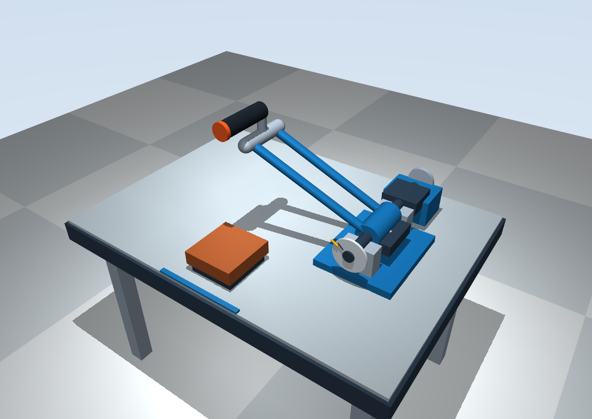

# armwrestling — 单自由度被动力反馈

## PC 通信桥接 V0.1

新增 `common/`：唯一公共控制实现、JSON 消息格式、最新状态协调和 PC TCP 桥接。`sim/` 保留 MuJoCo，并增加模拟 STM32 / VR；`real/` 预留真实接口，本次未修改。原 A 默认基线、C 候选和 D 分析结果保持不变。

**通信演示只需 Python 3.10+ 标准库，无需安装 MuJoCo。** Ubuntu 三个终端都进入 `/home/lyf/armwrestling`，分别执行：

```bash
python3 -m common.bridge
python3 -m sim.mock_stm32
python3 -m sim.mock_vr --demo-states
```

Windows PowerShell 三个终端都进入仓库根目录（如 `cd "$HOME\armwrestling"`），分别执行：

```powershell
py -3 -m common.bridge
py -3 -m sim.mock_stm32
py -3 -m sim.mock_vr --demo-states
```

默认 PC 监听 `127.0.0.1:9101`（STM32）和 `127.0.0.1:9102`（VR）。按 Ctrl+C 退出；模拟客户端支持重连，`--duration 10` 可定时退出。模拟 STM32 发送角度/速度并用收到的制动幅值参与动力学；VR 心跳传角色刚度、力矩上限和比赛状态，接收真实角度。`--demo-states` 周期切换运行/暂停，日志可观察制动力矩和状态变化。

协议为 **UTF-8 JSON + 换行**，含 `v=1`、消息类型和递增 `seq`，角度 rad、速度 rad/s、力矩 N·m。四种消息：

| 方向 / 类型 | 主要字段 |
| --- | --- |
| STM32 → PC / `telemetry` | `angle_rad`, `velocity_rad_s`, `device_status` |
| VR → PC / `vr_update` | `character_id`, `match_state`, `stiffness_nm_per_rad`, `max_torque_nm` |
| PC → STM32 / `brake_command` | `mode`, `reason`, `target_torque_nm`, `brake_torque_nm`, `valid_for_ms` |
| PC → VR / `status` | 角度/速度/q、目标与采样力矩、数据新鲜度、角色/比赛状态 |

PC 不等待 VR 与控制同步；遥测超过 0.25 s、VR 超过 1 s、断连/设备故障/比赛非运行状态均停止模拟输出，设备还独立检查 200 ms 指令有效期。有符号力矩是 PC 采样结果，模拟设备按当前速度重新确定阻碍方向，避免延迟换向助推。**模拟零力矩不等于实机安全电流；真实安全策略和标定仍待确认。** Windows 使用跨平台标准库实现，本次实际执行验证环境为 Ubuntu。

[完整协议、字段范围、错误处理、三终端说明与验证记录](docs/pc-bridge.md)。仅运行桥接测试：

```bash
python3 -m unittest common.test_bridge sim.test_bridge_clients sim.test_bridge_integration -v
```

## MuJoCo 阶段记录

阶段安排：**A 保留默认基线，C 为优先研究候选，D 保留为分析备选**。暂不替换默认模型，不继续优化外观。新增 [候选 C 的现有控制观察](docs/control-c-observation.md)：自由区对应 q≤0.25 rad，越界线性增阻；返回在越界区仍受制动，释放不会自动回零。现有行程足以展示自由/增阻/返回，名义最大目标为 0.6 N·m，不能达到 0.8 N·m 封顶。

为避开默认 0.5 N·m 输入过快触及限位的影响，可用已有输入参数观察 C：

```bash
.venv/bin/python -m sim.run --model sim/candidates/elbow_axis.xml --user-torque 0.15
```

1 下压，q≈0.4 时 0 释放，2 施力返回，接近零位 0 释放；零位不会自动停车。精确复现数据与曲线可运行 `.venv/bin/python -m sim.observe_c_control`，加 `--viewer` 可在窗口播放轻输入周期，需下述可选绘图依赖。此脚本不改 A/C 模型、控制律或原轨迹分析结果。

已增加 [固定肘部与握持轨迹适配分析](docs/trajectory-fit.md)：比较四个布局，区分肘垫接触点、肘关节中心、手腕中心和握持中点。原模型仍为默认；可独立观察 `sim/candidates/elbow_axis.xml` 候选 C，不能把示例人体参数当作已确认尺寸。

```bash
.venv/bin/python -m sim.run --model sim/candidates/elbow_axis.xml
```

绘图可选依赖：`uv pip install --python .venv/bin/python -r sim/requirements-analysis.txt`。历史分析入口为 `.venv/bin/python -m sim.fit_analysis`，会重生成 C XML 和原轨迹数据；当前冻结阶段不需要运行它。新控制观察使用独立输出目录。不绘图时交互仿真无需 Matplotlib。

单自由度被动力反馈扳手腕项目。`sim/` 验证自由空间阻力控制；`common/` 存放共用算法和 PC 桥接，`real/` 只预留实机软件。

## 安装与启动

已测试 Linux、Python 3.12.3、MuJoCo 3.17.0。在仓库根目录执行：

```bash
python3.12 -m venv .venv
.venv/bin/python -m pip install -r requirements.txt
.venv/bin/python -m sim.run
```

本机已安装时直接运行：

```bash
cd /home/lyf/armwrestling
.venv/bin/python -m sim.run
```

若环境没有 pip，可用 `uv pip install --python .venv/bin/python -r requirements.txt`。查看器需要图形桌面和 OpenGL。

点击查看器使其取得键盘焦点。按键切换持续用户力矩，不必按住：

| 操作 | 作用 |
| --- | --- |
| `1` / `2` / `0` | 获胜侧下压（负力矩） / 返回抬起（正力矩） / 释放用户力矩 |
| 鼠标左键拖动 / 右键拖动 / 滚轮 | 旋转 / 平移 / 缩放自由相机 |
| Shift 配合拖动 | 切换水平操作方向 |
| Tab / Shift+Tab | 切换左右面板 |
| 关窗 | 退出；Esc 为 MuJoCo 原生窗口/视角快捷键，不用作释放力矩 |

获胜侧已统一为负关节方向：默认 `forward_sign=-1`、`q=-θ`。`1` 对应 -0.5 N·m，`2` 对应 +0.5 N·m；返回键是持续施力，不自动停在零位。完整核查与三个下压侧视状态见 [方向核查](docs/direction-check.md)。

终端每约 0.25 s 输出角度、相对角度、边界、目标阻力、实际制动力矩和用户力矩。键盘输入通过 `qfrc_applied` 进入动力学，不直接修改关节角度。

```bash
.venv/bin/python -m sim.run --boundary 0.30 --stiffness 2.5 --max-brake 0.7 --user-torque 0.9
```

角度统一用弧度。`--duration 5` 在 5 秒后结束窗口测试。若用户力矩小于当前目标制动，低速近似会表现为缓慢移动。

## 机械布局与参考依据

已阅读 [资料说明](docs/references/README.md) 和 [简化草图](docs/references/armwrestling_layout.svg)。原始机械图没有提供；用户于 2026-11-07 补充说明目前没有具体图纸，允许按成人手臂的大致姿态设计。因此下述布局是草图支持下的**可运行近似**，不是对原始 CAD 的核对结论，也不是人体适配或加工尺寸。

- 坐标：Z 向上，用户坐在桌面 `y < -0.45 m` 一侧，桌前蓝色短条表示用户位置。
- 橙棕色肘垫中心 `(0, -0.30, 0.10) m`；初始握把中心 `(0, -0.192638, 0.49) m`，手从肘垫上举并略向桌内伸到握把。
- 水平主轴沿 **+Y**，穿过 `(0.34, 0.007362, 0.16) m`，由前后两个轴承支座承托。后方保留传动护罩与磁粉制动器外壳。
- 两根蓝色长杆平行安装，中心间距 0.11 m，每根中心线长约 0.439 m，由主轴轮毂连接到握把端横梁。它们与横梁构成同一个刚性摆臂，只有一个转动自由度；没有擅自增加四连杆铰链。
- 握把长轴为 (0,-1,0)，水平朝向用户，平行于主轴；摆臂运动中仍保持这个世界朝向，不需要额外保姿机构。握把中心到主轴的垂距约 0.474 m，绕主轴在 `y=-0.192638 m` 的竖直平面内走圆弧；不会在桌面内水平扫动。
- 关节正角度按 +Y 轴右手定则定义；获胜侧下压对应负角度，推进相对角 q 则为正。初始握把偏置 `r0=(-0.34,-0.20,0.33) m`，轨迹为 `p(θ)=p_axis + Ry(θ)r0`。限位范围 `[-0.55,1.2] rad` 仅用于这个示意布局。

双杆初始侧视抬升角从 V0.3 的 19.35° 恢复到 36.33°，端部相对主轴抬升 0.25 m、前伸 0.12 m。主轴靠右且降低，握把升高，而非压低摆臂来靠近肘垫。本次只改水平握持结构：保留主轴与双杆，在端横梁上增加 0.08 m 刚性短支座，使水平握把与杆件分开。握把长 0.16 m、半径 0.025 m；肘垫移到 Y=-0.30，握持中点前后距离约 0.10736 m，左右仍对齐。详细图像、数学证明、间隙及人体动作限制见 [水平握把验证](docs/horizontal-grip.md)。

[历史抬升对照](docs/layout-raised-zero.md) 包含已有草图、V0.3、新版的图像，以及同一相机/同一零位的斜俯视和侧视比较。原始图仍未提供，不能把已有草图称作原始 CAD。历史 [V0.3 对照](docs/layout-v03.md) 保留记录，当前参数以本节和水平握把验证为准。

默认自由相机采用方位 125°、俯角 35°；已比较同一姿态下的三个方位。

用户坐在蓝色短条一侧，把肘放在橙色垫上，手上举握住水平朝向自己的圆柱。**初始握持示意与全行程人体适配不同：当前固定肘参考点到握持中点的距离会显著变化，不能声称全程符合刚性前臂或手腕的自然运动。** 原因和量化结果见 [水平握把验证](docs/horizontal-grip.md)。



[用户正面](docs/previews/horizontal/front-zero.png)、[前臂侧面](docs/previews/horizontal/side-zero.png)、[零位/下压对照](docs/previews/horizontal/direction-comparison.png)。上一版 20° 方案留在 [历史用户握持布局](docs/operator-layout.md)，不再是当前朝向。

## 重力与被动配平假设

直接把旧模型改成水平 Y 轴，沿用旧的 1 kg 质量和偏置质心，会在零位产生约 **1.97 N·m** 的重力矩；这是旧质量模型的诊断值，不是对真实装置的测量。它超过默认制动上限 0.8 N·m，会使自重运动掩盖控制效果。磁粉制动器不能靠主动驱动抵消它。

本版保留 `gravity=(0,0,-9.81) m/s²`，将整个运动组件理想化为**已通过被动质量配平、总质心落在主轴上**的刚体。这样重力势能不随转角变化，关节重力矩为零。主轴后的小块仅示意被动配重；没有据其外形推断实际配重质量。

XML 显式指定运动组件质量 1 kg、质心在主轴、主轴等效惯量约 0.054695 kg·m²（沿用旧模型的转动惯量），装饰几何不再从外形自动估计质量。没有电机，没有 `gravcomp`，也没有任何补偿重力的控制力矩。真实结构能否实现这种配平、需要多少配重，仍需机械设计确认。未配平的真实设备将存在重力偏置，本仿真不代表其真实手感。

## 控制律与阻力可视化

`common/control.py` 存放唯一控制实现，`sim/control.py` 保留兼容导入；原控制律不变，且不依赖 MuJoCo：

```text
q = s(θ - θ0)
M(q) = min(Mmax, K × max(0, q - qb))
τb = -M(q) × clamp(ω / ωε, -1, +1)
```

默认 `θ0=0`、`s=-1`、`qb=0.25 rad`、`K=2.0 N·m/rad`、`Mmax=0.8 N·m`、`ωε=0.05 rad/s`；按键用户力矩幅值 0.5 N·m。当前负侧限位 -0.55 rad 内最高目标阻力约 0.6 N·m；公式的 0.8 N·m 上限仍保留，其对应角度超出当前下压行程。低速过渡连续且始终满足 `τbω≤0`，静止时无静态保持力矩。

自由空间边界改为安装在主轴前端、半径 0.055 m 的圆形刻度盘：深色短线是零位，黄色短刻度是边界。盘面垂直于主轴；黄色刻度的径向方向对应握把在边界转角处的圆弧方向，启动时按 `--boundary` 更新（默认 θ=-0.25 rad）。刻度盘与轴端相连，没有悬空长杆。

橙红色箭头表示**实际制动力矩**。令世界主轴单位向量为 `a`，轴到握把的向量为 `r`，切向 `t=(a×r)/|a×r|`。箭头方向由 `τb t` 决定，长度为 `0.22|τb| m`，不是以牛顿为单位的接触力测量。箭头起点沿握把自身轴向抬高 0.11 m，随握把倾斜一起移动；`|τb|<1e-6 N·m` 时隐藏。

`sim/visualization.py` 用 `mjv_initGeom` / `mjv_connector` 在 `viewer.user_scn` 中重建箭头；持有 `viewer.lock()` 修改场景，再由 `viewer.sync()` 显示。几何仅绘图、不施力、不参与碰撞。计算不再假定主轴竖直。接口见 [MuJoCo 官方 Python 文档](https://mujoco.readthedocs.io/en/latest/python.html)。

## 验证与限制

```bash
.venv/bin/python -m unittest discover -v
```

共 47 项测试：原有 30 项控制/MuJoCo 测试，包括自由区、线性增长、封顶、零速过渡、方向和制动功率，以及机械轨迹和可视化；另有 17 项桥接协议、状态、看门狗及真实 TCP 子进程测试。

实际打开查看器，从用户正面、前臂侧面、斜俯视运行下压/返回，检查三个零位视角和同相机下压图；另在完整角范围验证握把朝向恒定，在负角全行程验证几何间隙。人体全行程合理性未作为已通过项目。自动脚本输入用于复现，未把无界面测试当作窗口验证。

当前没有人体和真实接触约束；装饰碰撞禁用。肘垫不会约束用户肘部，未证明整个行程对人体可达或舒适。没有传动弹性、摩擦辨识、磁滞、延迟或热模型；握把的真实连接形式和配平方案仍需机械组确认。`real/` 本次未修改。

未来可复用纯 Python 控制律的逻辑与单位约定；实机仍需传感器方向、零位、速度估计、电流到制动力矩标定和故障处理。
