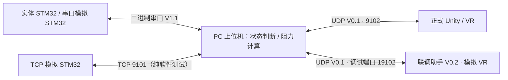
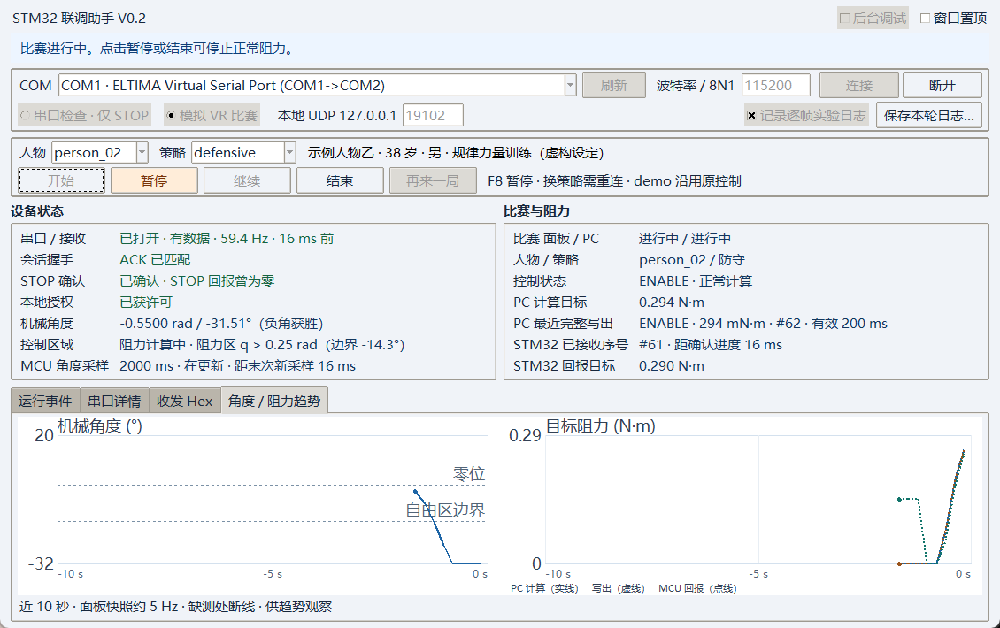

# 沉浸式力反馈单自由度扳手腕系统

本仓库负责 **PC 上位机、对抗控制、STM32 通信与独立联调工具**。通过角度传感器获取摆臂运动状态，计算虚拟对手的目标制动阻力，并与 VR 比赛画面同步。磁粉制动器是被动执行器，只阻碍运动，不主动驱动摆臂。

> 当前阶段：软件控制 V0.5-C、STM32 串口 V1.1 首次交接候选、联调助手 V0.2 已完成软件验证。下一步是实体 STM32 接板、机械参数测量和制动器台架标定。实际传感器、电气保护、固件及人体交互仍待验证。

## 1. 第一次接手：按你的分工选择入口

| 我负责的部分 | 从这里开始 | 不需要准备 |
| --- | --- | --- |
| **STM32 / 下位机** | [首次交接 START_HERE](handoff/stm32_v11/START_HERE.md) · [串口 V1.1 协议](docs/stm32-serial-v11.md) · [C 参考代码](firmware_reference/stm32_v11/README.md) | Unity、PICO、MuJoCo |
| **VR / Unity** | [正式 VR 工程](https://github.com/Ihtbfas/armwrestling-vr) · [UDP V0.1 协议](docs/vr-udp-v01.md) · [本 README 第 4 节](#4-vr-同学快速联调) | 实体 STM32、磁粉制动器 |
| **PC 控制与软件仿真** | [本 README 第 5 节](#5-pc-控制策略与软件仿真) · [控制模型说明](docs/character-library-v05c.md) | 实体硬件、头显 |
| **机械、电气及整机联调** | [硬件确认清单](handoff/stm32_v11/HARDWARE.md) · [实体联调流程](docs/real-vr-stm32-integration-v01.md) · [记录模板](docs/real-integration-record-template.md) | 先完成各自独立验证，无需等所有部分同时到位 |

下位机同学可以直接使用交接 ZIP 中的 Python 联调助手，选人物和策略、开始、暂停、继续、结束比赛，并查看串口收发和控制结果。**不必安装 VR 工程，也不必实现 PC 的人物与策略算法。**

## 2. 系统架构与接口



图中的串口和 TCP 是两种可选设备入口，正式 VR 与联调助手的模拟比赛也是两种可选客户端，并非全部同时运行。联调助手会自行启动串口后端，使用它时不必另开 `real.run`。

| 部分 | 职责 |
| --- | --- |
| STM32 | 主轴角度采集、零位与方向换算、速度/测力有效性、目标制动执行、本地授权、限幅和看门狗等独立保护 |
| PC | 人物能力、发力建立、疲劳恢复、策略选择、阻力计算、通信状态和实验记录 |
| VR | 角色选择、比赛流程、机械角度到虚拟手臂的映射及显示 |
| 机械与电气 | 实际行程、安装与受力、制动器驱动、电流—主轴阻力矩标定及独立保护 |

| 接口 | 主要约定 |
| --- | --- |
| STM32 ↔ PC | USB CDC 或 USART + USB 转串口；USART 默认 115200 / 8N1；V1.1 线上版本 `0x02`，`A5 5A` 帧头，CRC16/CCITT-FALSE；计划遥测 100 Hz、指令 50 Hz |
| PC ↔ VR | UDP V0.1；同机默认 `127.0.0.1:9102`；VR 每约 200 ms 发完整 JSON 状态，PC 目标回传频率 50 Hz |
| 纯软件模拟 | `common.bridge` 监听 TCP 9101 和 UDP 9102；模拟 STM32 产生机械状态，不经过实际串口 |

STM32 上传的角度、角速度以机械摆臂主轴为基准；机械零位为 0 rad，用户向获胜侧下压时角度为负。PC 下发的是**主轴侧目标阻力矩幅值**，不是 PWM、电流或主动驱动力矩。速度与测力未实现时按协议清相应有效位，不能将占位零值当成实际测量。

## 3. 下位机同学快速联调

### 3.1 准备环境并启动联调助手

解压交接包，或检出含 V1.1 与面板 V0.2 的仓库版本。以下命令在项目根目录的 Windows PowerShell 中执行。只需要 Python 3.10+（带 Tcl/Tk）和 pyserial；不需要安装 MuJoCo 的 `requirements.txt`。

```powershell
# 首次使用；已有 .venv 时跳过创建环境
python -m venv .venv
.\.venv\Scripts\python.exe -m pip install pyserial
.\start-stm32-debug.cmd
```

也可以双击 `start-stm32-debug.cmd`。脚本会检查实际使用的 Python、Tkinter 和 pyserial，并提示缺失依赖。手动启动入口为 `python -m tools.stm32_debug`（使用已安装依赖的 Python）。



面板具有两种模式：**串口检查 · 仅 STOP**（默认）用于握手、零目标确认、遥测和故障排查；**模拟 VR 比赛**用于独立选择人物及均衡、防守、节奏策略，操作比赛并查看阻力趋势。无需启动 Unity。

### 3.2 STM32 固件从这里接

完整字节格式、状态位、有效期和重连规则以 [串口 V1.1 协议](docs/stm32-serial-v11.md) 为准。C 参考文件位于 [`firmware_reference/stm32_v11/`](firmware_reference/stm32_v11/README.md)：

| 文件 | 用途 |
| --- | --- |
| [aw_protocol.h](firmware_reference/stm32_v11/aw_protocol.h) / [aw_protocol.c](firmware_reference/stm32_v11/aw_protocol.c) | C99 编解码、CRC16、流式帧解析 |
| [aw_session.h](firmware_reference/stm32_v11/aw_session.h) / [aw_session.c](firmware_reference/stm32_v11/aw_session.c) | 会话、STOP/ENABLE、授权与命令看门狗的参考逻辑 |
| [golden_vectors.txt](firmware_reference/stm32_v11/golden_vectors.txt) | Python 与 C 共用的 6 条黄金报文 |
| [test_aw_protocol.c](firmware_reference/stm32_v11/test_aw_protocol.c) | 主机编译测试 |

上述源码不依赖 HAL、不绑定引脚，也不包含实际 PWM/电流输出。下位机可将其移植到自己的工程，将实际串口字节、MCU 时间、传感器数据、本地保护及执行映射接入对应接口。具体接入顺序见 [C 参考说明](firmware_reference/stm32_v11/README.md)。

### 3.3 第一次接实体板

**先由下位机与电气组确认制动器励磁功率已物理隔离、设备旁无人接触。** 界面 STOP 只表示零阻力请求，不能代替独立急停、电气保护或机械停止。

1. 启动固件，打开联调助手；刷新并选择实际 COM 口，保持默认的仅 STOP 模式，点击连接。USART 采用双方确认的参数（默认 115200 / 8N1）。
2. 检查 RX/TX、合法帧、PC 与 STM32 的会话编号是否匹配，以及 SESSION_ACK 和 STOP/0 是否确认。未授权或角度尚未标定，不影响这一步的通信验收。
3. 检查 MCU 采样时间是否持续更新。角度有效后，在无励磁条件下核对零位、正负方向和单位。速度/测力尚未实现时清 `VEL_VALID` / `FORCE_VALID`。
4. 保持 COM 打开重启 STM32，观察是否自动重握手、重新确认 STOP，并保持等待或暂停；确认不会自动恢复非零阻力。
5. 勾选逐帧实验日志并保存本轮 ZIP。附固件版本、端口和复现步骤，便于双方定位问题。

| 面板现象 | 优先排查 |
| --- | --- |
| COM 打不开 | 端口选择、驱动、串口占用 |
| COM 已打开，RX 为 0 | 板端是否发送、接线、电平、端口 |
| RX 增长，合法帧为 0 | 波特率、版本 `02`、帧头、长度、CRC；复制 Hex |
| 有诊断遥测，但握手未完成 | SESSION_OPEN 是否收到，SESSION_ACK 是否回相同编号 |
| STOP 未确认或回报非零 | 命令解析、ACK 序号、板端目标更新 |
| STOP 已确认，未授权 | 本地许可、角度有效性和设备保护状态，不等于通信失败 |

详细流程见 [联调助手 V0.2 操作说明](docs/stm32-debug-panel-v02.md)；板端传感器、零位、测力类型、授权和标定方式需双方按 [硬件确认清单](handoff/stm32_v11/HARDWARE.md) 核实。

### 3.4 不依赖 Unity 的模拟比赛与日志

在软件模拟或励磁功率已物理隔离的条件下，先断开，再选择模拟 VR 比赛、人物和策略后重新连接。当前会话、STOP 零目标、有效角度及本地许可满足后才可手动开始。换策略需要断开重连；`demo` 保留原基线。支持暂停（F8）、继续、结束、再来一局，回合复位不等于机械回零。

默认离开窗口焦点会暂停；窗口置顶可选。仅软件仿真或已物理隔离励磁时，可在断开状态明确选择后台调试。最小化、GUI 卡顿、通信中断及设备异常仍会停止正常阻力请求；恢复需要人工继续。

如果尚无实体板，可使用一对已配置好的虚拟 COM 口复验 V1.1。以下 COM2↔COM1 只是示例：

```powershell
# 模拟器使用 COM2；面板选择配对的 COM1
.\.venv\Scripts\python.exe -m sim.mock_stm32_serial --port COM2
# 如需测试已授权的模拟比赛，停止上述模拟器后使用：
.\.venv\Scripts\python.exe -m sim.mock_stm32_serial --port COM2 --demo-arm
```

`--demo-arm` 只适用于软件模拟器，不是实板授权命令。Ubuntu 可参考 [Linux PTY 软件串口路线](docs/serial-pty-demo.md)。

面板实时显示原始收发统计、Hex、自由区/阻力区、PC 计算目标、串口完整写出目标、STM32 ACK 和回报目标。趋势图使用约 5 Hz 的快照，仅用于观察趋势。需实验数据时，在连接前勾选逐帧日志；结束后先断开，再保存本轮日志。

```powershell
.\.venv\Scripts\python.exe -m tools.plot_experiment ".\本轮日志.zip" --out-dir ".\analysis"
```

离线工具输出逐帧 CSV、统计摘要和可用的 PC 快照 CSV。MCU 采样时钟与 PC 单调时钟分别分析；板端回报目标并非实测力矩。详见 [V0.2 操作及数据记录](docs/stm32-debug-panel-v02.md)。

## 4. VR 同学快速联调

正式人物、场景、动作、IK 与头显相关工作位于 [armwrestling-vr](https://github.com/Ihtbfas/armwrestling-vr)，本仓库只提供 PC 控制与通信端。使用 Python 的 TCP 模拟下位机即可独立完成 VR 联调，无需真实板卡、虚拟 COM、MuJoCo 或头显。

### 4.1 运行正式场景与软件机械

创建 Python 环境后，在本仓库根目录打开两个 PowerShell：

```powershell
# 窗口一：PC 上位机（TCP 9101 + UDP 9102）
.\.venv\Scripts\python.exe -m common.bridge --log-file "$env:TEMP\arm-pc.jsonl"
# 窗口二：手动模拟用户施力（Windows）
.\.venv\Scripts\python.exe -m sim.mock_stm32 --manual --torque 0.6
```

打开正式 VR 仓库的 `Assets/Scenes/ArmWrestlingMain.unity`，进入 Play，选择网络数据，连接 `127.0.0.1:9102`，完成选角和比赛流程。模拟器窗口按 `1` 下压、`2` 回推、`0` 松手、`R` 软件回零。按键切换持续模拟施力，不是直接改角度；`R` 仅为模拟器功能。

也可使用 `--sequence down:2,back:1,release:0.5` 或 `--input-file` 做可重复输入；省略这些输入选项时沿用原周期施力。详见 [PC 桥接说明](docs/pc-bridge.md) 和 [P3.0 正式场景联调](https://github.com/Ihtbfas/armwrestling-vr/blob/129c989035b7657af526f9eec9bfe6eebea50e56/docs/P3-0-pc-integration.md)。

没有 Unity 时，可用 `python -m sim.mock_vr --character-id person_02 --demo-states` 作为命令行 UDP 测试客户端（需 PC 与 TCP 模拟器已启动）。`tests/unity/` 是参考客户端而非正式 VR 工程；需要它时见 [Unity 测试工程说明](docs/windows-unity-udp-test.md)。

### 4.2 VR 接口要点

VR 使用同一个 UDP socket 收发完整 JSON 数据报，每约 200 ms 发送当前人物与比赛状态，即使状态不变也要持续发送。两端各自维护递增序号。具体字段及超时规则见 [UDP V0.1 协议](docs/vr-udp-v01.md)。

VR → PC（准备阶段示例）：

```json
{"v":1,"type":"vr_update","seq":0,"character_id":"person_02","match_state":"waiting"}
```

PC → VR（正常比赛时示例）：

```json
{"v":1,"type":"status","seq":20,"angle_rad":-0.4,"mode":"enabled","reason":"running"}
```

准备和倒计时使用 `waiting`，正式开赛才发送 `running`；暂停、结束分别使用 `paused`、`finished`。`angle_rad=null` 表示角度无效，不能当作机械零位；有效角度在 STOP 时仍可用于显示。`enabled` 是 PC 正常控制计算状态，不是实际硬件授权。

联网人物 ID 为 `demo`、`person_01`、`person_02`、`person_03`，控制策略在 PC 选择，不新增 UDP 字段。不要同时启动两个 VR 客户端争用同一 PC 入口。跨设备连接、网络绑定及防火墙配置见 [分线与整机联调说明](docs/real-vr-stm32-integration-v01.md)。

## 5. PC 控制策略与软件仿真

PC 的公共控制层供真实串口、TCP 软件模拟和联调助手共同使用，不需要将人物模型移植到 STM32。

| 模块 | 当前版本与说明 |
| --- | --- |
| 人物参数 | [V0.1](docs/character-library-v01.md)，demo 与三个虚构示例人物 |
| 发力建立 | [V0.2](docs/character-library-v02.md)，各人物的演示建立常数 |
| 疲劳与恢复 | [V0.3](docs/character-library-v03.md)，等效疲劳、暂停恢复及新回合复位 |
| 独立策略 | [V0.4](docs/character-library-v04.md)，均衡 `balanced`、防守 `defensive`、节奏 `rhythmic` |
| 阻力区域 | [V0.5-A](docs/character-library-v05a.md)，原自由区与小自由区等对照 |
| 方向响应 | [V0.5-B](docs/character-library-v05b.md)，可选回推减阻 |
| 反应延迟与滑行 | [V0.5-C](docs/character-library-v05c.md)，软件控制阶段收口 |

默认控制为 `legacy + symmetric + 0 ms`，原自由区边界为推进量 q=0.25 rad（机械角约 −14.3°）。`narrow + symmetric + 0 ms` 为下一阶段优先验证候选；`relief` 和反应延迟等仅作为软件实验选项，未开放到真实串口。人物参数均为演示设定，不是人体测量数据或实物安全限值。

例如，在 TCP 软件仿真中选择节奏策略与小自由区：

```powershell
.\.venv\Scripts\python.exe -m common.bridge --strategy rhythmic --resistance-profile narrow
.\.venv\Scripts\python.exe -m sim.mock_stm32 --torque 0.09 --sequence release:1.2,down:0.66,release:1.2,back:0.22,release:1.72
```

上述命令分别在两个终端运行，另用正式 VR 或 `sim.mock_vr` 选非 demo 人物并发送比赛状态。模拟施力不是实际人体力矩。

MuJoCo 是独立机械与控制研究环境，不参与以上通信测试。需要时再安装依赖并启动：

```powershell
.\.venv\Scripts\python.exe -m pip install -r requirements.txt
.\.venv\Scripts\python.exe -m sim.run
```

机械布局、理想配平和模型历史见 [轨迹适配分析](docs/trajectory-fit.md) 与 [机械仿真记录](docs/project-history-20261115.md)。

## 6. 实体设备与正式 VR 合并联调

先分别完成第 3 节的真实串口通信验证与第 4 节的 VR 软件联调。随后由机械、电气和下位机组确认硬件独立保护、真实行程、驱动映射及无人台架标定条件，再开展对应实物实验。

从软件机械切换到实体设备时，先关闭模拟器、`common.bridge` 及调试面板占用的串口。PC 正式串口入口为 `real.run`。第一次接板仍优先用面板的仅 STOP 模式，或者在励磁功率物理隔离条件下运行：

```powershell
# COM9 仅为示例，替换成实际设备端口
.\.venv\Scripts\python.exe -m real.run --port COM9 --vr-port 19102 --monitor-only --log-file pc.jsonl --experiment-log experiment.jsonl
```

待实体通信、保护与标定条件确认后，正式 VR 联调使用 `real.run --port 实际COM` 的默认 UDP 9102 入口。`common.bridge` 与 `real.run` 不应同时占用 9102；面板会自行管理其后端，不能与其他程序同时打开同一 COM。

完整操作按 [实际联调流程](docs/real-vr-stm32-integration-v01.md) 执行，并填写 [联调记录模板](docs/real-integration-record-template.md)。

## 7. 仓库目录与验证记录

```text
armwrestling/
├── common/                 控制模型、人物策略、通信协议与状态机
├── real/                   真实串口后端、实验日志
├── sim/                    TCP / 串口模拟 STM32、模拟 VR、MuJoCo
├── tools/                  独立联调助手、趋势显示、日志离线分析
├── firmware_reference/
│   └── stm32_v11/          C 参考源码、黄金报文及主机测试
├── handoff/stm32_v11/      首次交接说明、硬件清单及日志节选
├── tests/                  联调与实验复现脚本
├── docs/                   协议、操作说明、图表及各阶段验收
├── start-stm32-debug.cmd    Windows 联调助手启动脚本
└── TASKS.md                当前进度及历史待办
```

| 阶段 | 已验证的范围 | 记录 |
| --- | --- | --- |
| P3.0 正式 VR 联合仿真 | 正式 Unity Editor、TCP 模拟机械、比赛与异常恢复 | [P3.0 报告](https://github.com/Ihtbfas/armwrestling-vr/blob/129c989035b7657af526f9eec9bfe6eebea50e56/docs/P3-0-pc-integration.md) |
| V0.5-C 软件控制 | 人物策略、阻力区域、方向与延迟对照 | [控制收口](docs/character-library-v05c.md) |
| 串口 V1.1 | Windows 虚拟 COM、会话复位、采样和 ACK 监控、Python/C 黄金报文 | [V1.1 验收](docs/stm32-serial-v11-windows.md) |
| 联调助手 V0.2 | 实际 Tk 窗口、原始串口诊断、STOP 零目标门控、趋势及日志 | [V0.2 验收与截图](docs/stm32-debug-panel-v02-windows.md) |
| 实体 STM32、制动器、PICO 与完整人机实验 | 待实际设备及双方保护/标定验证 | [TASKS](TASKS.md) · [硬件确认清单](handoff/stm32_v11/HARDWARE.md) |

当前 V1.1 仍是首次对接候选，待下位机组确认固件和实物行为后冻结。原 [串口 V1](docs/stm32-serial-v1.md) 及 [参考 Unity/终端测试记录](docs/windows-serial-operator-guide.md) 保留供历史复现，不作为新版板端报文定义。
