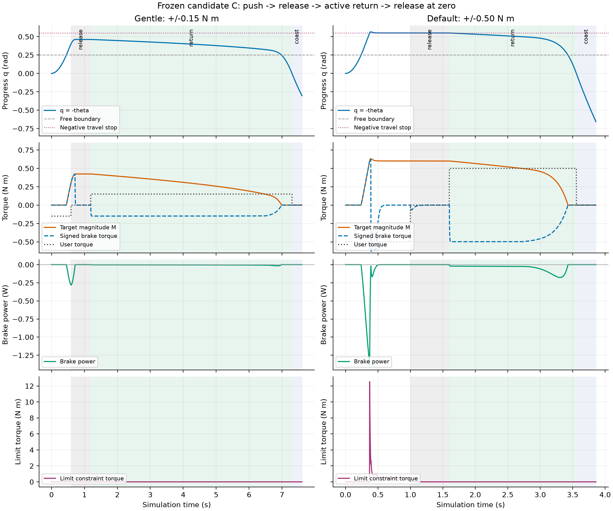

# 候选 C：现有自由空间阻力控制观察

本次只观察现状，不更改机械布局或控制策略。以提交 `dda198178a0c507d93482d8635424b4b1fcebd0b` 为冻结依据：A（`sim/arm.xml`）继续作为默认可复现基线，C（`sim/candidates/elbow_axis.xml`）是优先研究候选，D 保留为原轨迹分析结果。原分析数据不重算、不覆盖；本次数据单独存入 `docs/analysis/control-c/`。

结论：候选 C 下方向、自由区和线性增阻仍正确；没有发现必须修改控制律的问题。需要明确的是，现有制动也会阻碍越界区内的返回，松手不会自动回零；默认用户输入偏大，容易很快碰到限位。当前行程能展示自由运动、渐增阻力和主动施力返回，但不能展示 0.8 N·m 封顶。

## 1. 参数与空间对应关系

保持原参数：

```text
q = -theta
M = min(0.8, 2.0 * max(0, q - 0.25))
tau_b = -M * clamp(omega / 0.05, -1, +1)
```

角度单位 rad，力矩 N·m。获胜侧为负关节转动；按键 1 施加负用户力矩，按键 2 施加正用户力矩返回，按键 0 仅释放用户力矩。目标 M 由位置决定，实际制动力矩还取决于速度。静止时实际制动力矩为零，没有静态锁止。

C 主轴沿 +Y，轴位 `(0, 0.007361611466, 0.163) m`；握持中心零位为 `(0, -0.192638388534, 0.49) m`。其轨迹：

```text
x = 0.327 sin(theta)
y = -0.192638388534
z = 0.163 + 0.327 cos(theta)
```

向获胜侧推进时，握持点向负 X 侧倾并下降；此候选以侧倾为主，不能将角行程理解为同样大小的垂直下降。水平握把长轴仍为负 Y。初始最高点的垂直速度为零，但圆弧切向速度并不为零。

| 推进 q | 关节 theta | 握持 X / Z（m） | 目标 M（N·m） | 所处区域 |
| --- | --- | --- | --- | --- |
| 0 | 0 | 0 / 0.4900 | 0 | 零位 |
| 0.10 | -0.10 | -0.0326 / 0.4884 | 0 | 自由区 |
| 0.25 | -0.25 | -0.0809 / 0.4798 | 0 | 自由区边界 |
| 0.35 | -0.35 | -0.1121 / 0.4702 | 0.20 | 阻力区 |
| 0.40 | -0.40 | -0.1273 / 0.4642 | 0.30 | 阻力区 |
| 0.45 | -0.45 | -0.1422 / 0.4574 | 0.40 | 阻力区 |
| 0.55 | -0.55 | -0.1709 / 0.4418 | 0.60 | 名义负限位 |

数据见 [angle-map.csv](analysis/control-c/angle-map.csv)。自由区是从零位起 0.25 rad（14.32°），对应 81.75 mm 握持圆弧，下降约 10.17 mm。随后 0.30 rad（17.19°）是线性增阻区，对应 98.10 mm 圆弧、再下降约 38.06 mm。边界显示仍在 theta=-0.25 rad；采用 C 自身的主轴与径向，未挪用 A 的空间位置。

名义 q 上限 0.55 时 M=0.60 N·m；达到 0.8 N·m 需要 q=0.65，超出当前下压行程。因此没有为了展示封顶而改变边界、刚度或机械限位。

## 2. 两段动力学观察

`sim/observe_c_control.py` 调用现有 `brake_state` 与键盘力矩映射，将脚本输入作为 `qfrc_applied`，每 0.002 s 由 MuJoCo 积分。动态过程不直接设置角度。另有明确分开的静态运动学查表，用于上表。

两种输入都经历下压、释放 0.6 s、反向施力直到过零、再释放 0.3 s：

- **轻输入**：用户力矩幅值 0.15 N·m，下压到 q≥0.40 后释放。此幅值是已有运行参数，不是修改控制器默认值。
- **默认输入**：幅值 0.50 N·m，持续下压 1.0 s 后释放，用于观察限位干扰。

| 指标 | 轻输入 | 默认输入 |
| --- | --- | --- |
| 首次越过自由边界 | 0.450 s | 0.240 s |
| 最大 q | 0.46180 rad | 0.56472 rad |
| 最大目标 M | 0.42360 N·m | 0.62943 N·m |
| 限位约束出现 | 无 | 首次约 0.372 s |
| 最大约束力矩绝对值 | 0 | 12.542 N·m |
| 反向施力返回到零附近用时 | 6.112 s | 1.958 s |
| 采样最大制动功率 | 0 W | 0 W |
| 采样制动功积分 | -0.07109 J | -0.19587 J |

MuJoCo 限位为软约束，所以默认输入会短暂越过名义 q=0.55。12.542 N·m 是限位约束力矩，**不是控制器制动力矩**；碰限位过程不能作为线性阻力手感的证据。轻输入全程未触及限位，适合分辨控制效果。



图中列分别对应两种输入；行分别为推进角、目标/实际/用户力矩、制动功率、限位约束力矩。灰色为释放，浅绿为施力返回，浅蓝为过零后释放；未着色段为下压。原始记录：[轻输入](analysis/control-c/gentle.csv)、[默认输入](analysis/control-c/default.csv)、[汇总](analysis/control-c/summary.json)、[PDF](analysis/control-c/control-observation.pdf)。

## 3. 返回与松手的具体表现

**返回仍有阻力。** 只要 q>0.25，M 就大于零。下压 omega<0 时 tau_b>0，返回 omega>0 时 tau_b<0；返回过程中 q 减小，目标阻力逐渐减小，进入自由区后消失。它不是弹簧，不会把机构推回零位。

**目标相同不代表实际力矩相同。** 轻输入在 q≈0.40 下压时速度约 -0.943 rad/s，M≈0.298、实际力矩≈+0.298 N·m；返回到同一位置时速度约 +0.0248 rad/s，M≈0.300，实际约 -0.149 N·m。后者处于 0.05 rad/s 低速过渡区，所以轻力矩可缓慢返回。这是原有近零速近似的表现，不是新加入的返回策略。

**释放不等于停止或回零。** 轻输入在 q≈0.40 释放后，惯性使其继续到 q≈0.4618，随后近乎停住；理想重力配平下没有使它回零的恢复力。若在零位附近带速度释放，则仍会惯性越过零位：本次轻输入过零释放 0.3 s 后 q≈-0.303，默认输入为 -0.656。控制器在该自由侧无额外制动，原关节黏性阻尼 0.04 N·m·s/rad 仍存在。“自由”表示无额外控制制动，不表示完全无阻尼。

按键 2 是持续的正向力矩，仅在获胜侧行程内可称作返回；越过零位后继续按该键会进入另一侧。C 零位处握持高度最高，越过零位后向另一侧运动也会下降，不能把按键 2 永久理解为升高握把。

**被动性没有改变。** 公式直接保证 tau_b*omega≤0；两段轨迹全部采样亦无正制动功率。零速输出为零，方向切换连续。该记录是当前离散轨迹的功率检查，不是对真实磁粉制动器静态摩擦、延迟或硬件能量特性的验证。用户输入和限位约束的功率不能算作制动器功率。

## 4. 当前建议与复现

保留 A 默认、C 优先观察、D 分析备选，不修改既有公式和冻结结果。当前范围足以展示三阶段，但默认 0.5 N·m 输入约 0.37 s 就到限位，人工操作难以分辨。建议先使用已有输入选项，降低用户模拟力矩并缩短下压段：

```bash
cd /home/lyf/armwrestling
.venv/bin/python -m sim.run --model sim/candidates/elbow_axis.xml --user-torque 0.15
```

点击窗口获取焦点。1 下压，观察 q 刚越过 0.25 后增阻；在 q≈0.4 附近按 0 释放，随后按 2 施力返回，接近零位按 0。按键切换持续力矩，无需按住；没有自动停位保证。若希望准确复现本报告短程输入，用下述脚本，不依赖人工反应时间。

```bash
# 如尚未安装绘图依赖：
uv pip install --python .venv/bin/python -r sim/requirements-analysis.txt
# 无界面重算两段数据和图：
.venv/bin/python -m sim.observe_c_control
# 实际查看器播放轻输入周期，其余数据仍无界面计算：
.venv/bin/python -m sim.observe_c_control --viewer
```

本次在 Linux / MuJoCo 3.17.0 下实际启动查看器，轻输入周期完成并退出；这次是脚本力矩驱动的窗口观察，没有重新做人工键盘或鼠标手势验证。无界面和窗口运行均检查自由区零目标、制动功率非正、可施力返回，轻输入无约束干扰。现有 30 项测试重新运行通过。

运行脚本会校验 A/C XML、控制文件及原 `docs/analysis/fit/` 所有文件哈希前后不变，记录于 [frozen-inputs.json](analysis/control-c/frozen-inputs.json)。本次未改 `sim/run.py`、可视化代码或 `real/`。

当前不需要修正控制算法。若以后要求“返回无额外阻力”，需明确改变现有双向耗能要求；若要求松手自动回零或自动停零，也不能由当前被动位置制动直接保证，本次不加入这些功能。理想重力配平继续仅用于算法验证，不代表真实机构已完成配重或具备主动补偿能力。
