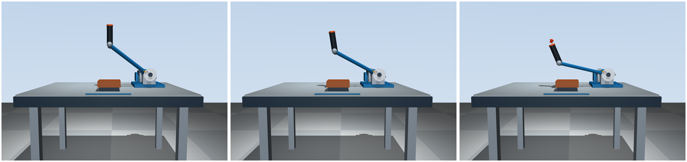

# 获胜侧下压与控制方向核查（2026-11-08）

> 本文数值和截图记录提交 fdff920 的旧握持几何。后续已调整用户握持布局，当前坐标见 [用户握持布局](operator-layout.md)；下压负 θ、forward_sign=-1、控制公式与按键定义保持不变。

## 结论与修正

提交 `6c88b55` 的主轴为 +Y，零位握把偏置 `r=(-0.34,-0.12,0.33) m`，世界高度为：

```text
z(θ) = 0.16 + 0.34 sin(θ) + 0.33 cos(θ)
```

零位 `z=0.49 m`，`θ=+0.25` 时约 0.5639 m，`θ=-0.25` 时约 0.3956 m。在本次操作范围 `-0.55≤θ≤0` 内，θ 减小对应握把持续下压。因此旧默认 `forward_sign=+1` 确实让控制器在抬起侧越界后增加阻力，与本次明确的获胜侧下压动作不一致。

本版规定获胜侧为负关节角下压方向，默认改为 `forward_sign=-1`，公式保持：

```text
q = -(θ - θ0), θ0 = 0
M = min(Mmax, K max(0,q-qb))
τb = -M clamp(ω/ωε,-1,1)
```

K=2.0 N·m/rad、qb=0.25 rad、Mmax=0.8 N·m、ωε=0.05 rad/s 均保留。下压时 ω<0，制动力矩 τb≥0；返回时若仍处于阻力区域，ω>0，制动力矩 τb≤0。回到自由区后目标阻力归零。

这是当前模型的坐标约定，不是所有左右手布局的通用转角符号。真实设备仍需标定主轴和编码器方向。

## 按键、边界与零位

- `1`：获胜侧下压，默认关节用户力矩 -0.5 N·m。
- `2`：反向返回/抬起，默认关节用户力矩 +0.5 N·m。
- `0`：释放用户力矩。按键为持续输入，返回键不自动停在零位，需按 0 停止施力。
- `sim/run.py` 的 `keyboard_torque` 根据同一 `forward_sign` 生成关节力矩，避免按键与控制器分别硬编码正负。
- 关节零位仍 θ=0，没有改变初始几何。黄色边界刻度对应 θ=−0.25 rad，启动时由同一参数计算；XML 的默认刻度也改为负侧。
- 深色零位刻度保持原位置。握把圆弧、轴线、杆长、初始倾角和机械限位均未改动。

负侧机械限位仍为 -0.55 rad，故可达目标阻力最高约为 2×(0.55−0.25)=0.6 N·m。公式仍有 0.8 N·m 上限，但它对应 θ≤-0.65 rad，位于当前下压行程之外；没有为演示封顶扩大机械行程。

## 同一实际下压过程的三个侧视状态

同一自由相机方位 90°、仰角 -5°。查看器实际打开，脚本调用与按键相同的力矩映射：用幅值 0.15 N·m 下压以便取样，然后释放，再以 0.8 N·m 幅值返回。除默认初始状态外，没有写 qpos 设置截图姿态，全部由 MuJoCo 动力学积分获得。

左到右依次为零位、下压自由区、越界受阻：



| 状态 | θ / rad | q / rad | 握把高度 / m | 目标阻力 / N·m | 实际制动力矩 / N·m |
| --- | --- | --- | --- | --- | --- |
| 零位 | 0 | 0 | 0.4900 | 0 | 0 |
| 下压未越界 | -0.150207 | 0.150207 | 0.435406 | 0 | 0 |
| 下压已越界 | -0.400626 | 0.400626 | 0.331271 | 0.301252 | +0.301252 |

越界状态角速度约 -0.9363 rad/s，制动功率约 -0.2821 W；箭头为向上的等效切向，阻碍握把下压。它不是新的施力源。

后续释放并返回后，关节角约 -0.0960 rad，已经回到自由区。整段采样的制动功率最大值为 0，按 τbωΔt 累积的制动功约 -0.08952 J（输入用户力矩自身可以做正功，不计作制动器供能）。

## 验证与假设

- 21 项测试通过，覆盖默认符号、实际按键映射、下压高度单调降低、边界内零输出、越界增长、限幅、负侧边界刻度、双向非正制动功率与低速过渡。
- 通用正方向参数的原公式测试继续保留；默认应用和动力学测试采用新下压方向。动力学测试缩短连续下压时间以避开 -0.55 rad 限位，防止把限位反力当作制动效果，没有放宽阻力或被动性要求。
- 从公式直接有 `τbω=-M|ω|min(1,|ω|/ωε)≤0`，包括返回及方向切换。
- 实际查看器与正常入口均已运行并正常关闭。图像由 MuJoCo Renderer 使用窗口检查的同一状态和相机生成。
- 理想被动配平仍只是控制验证假设：没有增加电机、gravcomp 或主动重力补偿，不代表真实设备完成配重设计。
