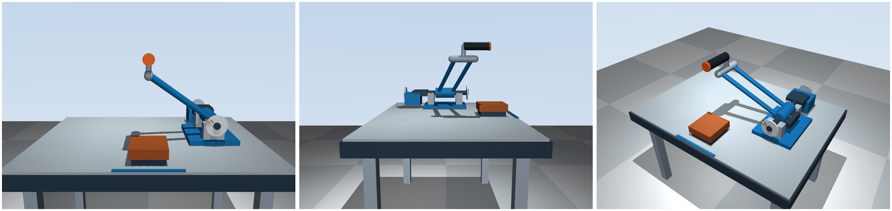
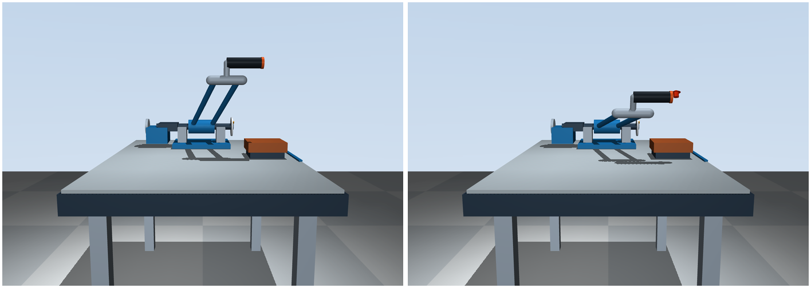

# 水平负 Y 握把验证（2026-11-08）

## 结论

握把长轴已经改为 `(0,-1,0)`，朝向位于负 Y 的用户，替代上一版向用户倾斜 20° 的近竖直握把。

主轴沿 +Y，而 `Ry(θ)(0,-1,0)=(0,-1,0)`，因此即使握把与摆臂刚性连接，其轴向也保持不变。这里只旋转一个刚体，没有增加执行器、保姿关节或动画。

## 用户侧、前臂侧面和整体观察

从左到右：用户坐在负 Y 桌前时看到的正面、前臂侧面、斜俯视。全部是 θ=0，同一次模型、各自自由相机。正面看到橙色端面，是因为圆柱确实指向观察者，不是握把缩成了一个球。

[用户正面](previews/horizontal/front-zero.png) / [前臂侧面](previews/horizontal/side-zero.png) / [斜俯视](previews/horizontal/oblique-zero.png)。

## 安装与肘垫位置

保持上一版主轴、双杆长度、抬升角和后部结构。握把长度仍为 0.16 m、半径 0.025 m。为避免圆柱直接穿过一侧双杆端部，在横梁上增加 0.08 m 简单刚性支座，握把从支座顶端沿负 Y 水平伸出。

零位世界坐标（m）：

| 位置 | 数值 |
| --- | --- |
| 肘垫中心 | (0,-0.30,0.10) |
| 肘垫顶面参考点 | (0,-0.30,0.123) |
| 握把后端安装点 | (0,-0.112638,0.49) |
| 握把中点 / 示意握持点 | (0,-0.192638,0.49) |
| 握把前端（不含端盖） | (0,-0.272638,0.49) |
| 主轴基准点 | (0.34,0.007362,0.16) |

肘垫前移到 Y=-0.30，仍在桌内；握持点与肘垫左右中线均为 X=0，前后差约 0.10736 m，并非强行保留 0.10 m。用户可从桌前把肘置于垫面、手上举握住水平圆柱中段；这是初始几何意图，不能替代实际握持测试。

## 下压时握把朝向

下图左零位，右为同一次施力积分得到的 θ≈-0.400626 rad。相机完全相同，圆柱始终水平、朝用户侧。

- 在完整关节范围 `[-0.55,1.2] rad` 取 101 个角度，握把世界轴向保持 `(0,-1,0)`。
- 实际查看器分别在三个视角运行下压/返回，记录到的最大轴向误差约 `4.4e-16`。
- 下压截图握把高度约 0.33127 m，实际制动力矩约 +0.30125 N·m，阻碍负角下压。
- `q=-θ`、自由区 qb=0.25 rad、线性增长与低速被动制动公式不变。刻度盘径向按新握持点更新。

## 几何间隙与人体动作是两项不同检查

保持装饰碰撞禁用，用 `mj_geomDistance` 独立计算 101 个负角状态 `[-0.55,0]` 下圆柱与各几何体的最小表面距离，结果为：

| 握把对其他几何 | 最小距离 |
| --- | --- |
| 前侧双杆之一 | 0.0410 m |
| 另一根杆 | 0.0638 m |
| 肘垫 | 0.1205 m |
| 桌面 | 0.1916 m |

支座与横梁、握把是设计连接，不算干涉。上述结果只检查现有简化几何，不包含手指、手掌或真实制动机构，不是实物安全间隙认证。

**整个下压行程尚不满足“固定肘参考点 + 固定握持中点 + 刚性前臂长度不变”的条件。** 肘垫顶面中心到握把中点的距离，零位约 0.38238 m，在 θ=-0.55 rad 时约 0.21510 m，改变约 0.1673 m。原因是主轴在肘部右侧，机械圆弧不以肘参考点为圆心。水平握把消除了握把轴向变化，但没有自动消除这个距离变化，也不能据此认定手腕姿态全程合理。

真实用户可能移动肘部、改变握持位置或姿态，但本版没有模拟或验证这些补偿。本次只完成水平握把方案与明确的几何检查；完整人体操作适配仍需确认主轴—肘部关系或实际机构方案，没有增加额外关节来掩盖它。

## 验证记录

- 26 项测试通过；新增全关节范围轴向恒定、握把支撑连接和负角全行程几何间隙检查。
- 实际查看器从正面、前臂侧面、斜俯视分别施加与按键相同的下压/返回用户力矩，正常退出。下压图来自连续动力学积分，没有直接改 qpos 摆拍。
- 图片由 MuJoCo Renderer 使用窗口检查的同一状态与相机生成。
- 控制代码、单自由度、重力和理想被动配平惯量、默认自由相机、`real/` 均未修改。理想配平不是实物配重已经完成。
