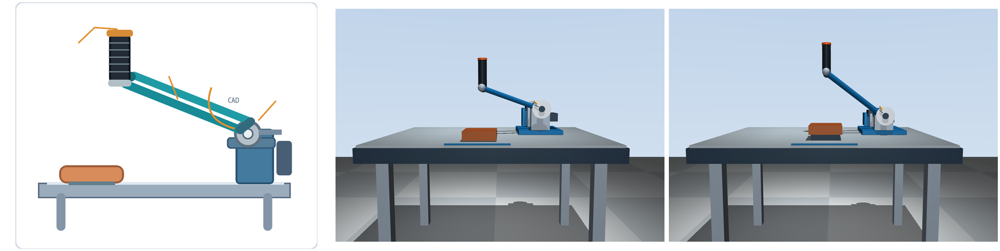
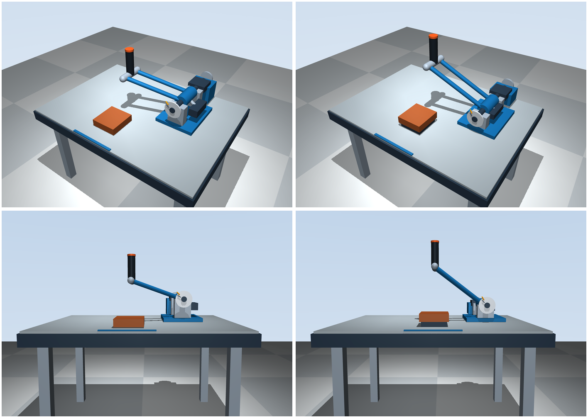

# 抬升零位修正：已有草图、V0.3 与新版（2026-11-08）

> 历史布局记录：后续已将默认获胜方向修正为负角下压，边界为 θ=-0.25 rad；当前方向以 [方向核查](direction-check.md) 为准。

## 依据及对照限制

仓库仍只有 `docs/references/armwrestling_layout.svg` 与说明，没有原始机械参考图或最终 CAD。本次依照用户明确提出的“恢复约 34.51° 或更合适的明显上倾姿态”要求，采用 36.33° 的侧视投影抬升角。下图左侧是已有简化草图的侧向局部，不是未提供的原始机械图；草图不用于读取角度、尺寸或配合精度。

左：已有草图；中：V0.3 初始姿态；右：新版初始姿态。侧视中两根杆因投影重叠，需结合斜俯视观察。

## 同相机、同零位对照

左列为提交 `1bcb69f` 的 V0.3，右列为本次修改。上排斜俯视、下排侧视，全部为 θ=0。斜俯视沿用 125°/-35°，侧视沿用 90°/-5°，相机焦点和距离也完全相同，没有用换镜头制造相似效果。

## 实际几何变化

单位 m。Y 正向朝桌后、Z 向上；用户位于负 Y 桌边。

| 项目 | V0.3 | 新版 |
| --- | --- | --- |
| 主轴基准点 | (0.2800, 0.1000, 0.2000) | (0.3400, 0.1000, 0.1600) |
| 两根杆的共同端点偏置 | (-0.34176015, -0.14, 0.12) | (-0.34, -0.12, 0.25) |
| 每根杆中心线长 | 0.388330 | 0.438748 |
| 杆侧视 XZ 抬升角 | 19.35° | 36.33° |
| 握把中心 | (-0.06176015, -0.04, 0.40) | (0, -0.02, 0.49) |
| 肘垫中心 | (-0.06176015, -0.24, 0.075) | (0, -0.20, 0.10) |
| 握把—肘垫水平距离 | 0.20 | 0.18 |
| 握把—肘垫中心高度差 | 0.325 | 0.390 |
| 握把中心高于肘垫顶面 | 0.302 | 0.367 |
| 握把圆弧半径 | 0.395980 | 0.473814 |
| 零位握把与世界 Z 轴夹角 | 0° | 0° |

主轴和后部模块整体右移 0.06 m，主轴降低 0.04 m，轴承座和制动壳体同步降低。双杆端部抬升从 0.12 m 增到 0.25 m，同时保留 0.12 m 的前伸；没有为了靠近肘垫而压低摆臂。握把实际升高 0.09 m，肘垫只抬高 0.025 m，并有与桌面相接的独立底座。

这些是布局示意值，不是成人适配结论。手从肘垫区域向上前伸到握把的意图更清楚，但是否适合具体用户仍需人体尺寸和样机验证。

## 零位、轨迹与自由空间边界

- 初始关节角仍为 θ=0，控制零位 θ0=0；上倾角写在杆的局部几何中，没有把关节初始化到一个已经越过边界的角度。
- 主轴仍沿 +Y。握把中心轨迹为 `p(θ)=(0.34,0.10,0.16)+Ry(θ)(-0.34,-0.12,0.33)`，在 `y=-0.02` 的竖直平面内走圆弧。
- 默认边界 `qb=0.25 rad` 是从本次零位继续转动的关节角，边界处握把中心约 `(0.0922,-0.0200,0.5639) m`。
- 轴端深色刻度按新的零位径向重画，黄色刻度按参数旋转；测试确认黄色径向和 θ=qb 时的握把径向一致。
- 握把只在初始姿态竖直，运动中仍随双杆倾斜。没有新增保姿关节、主动执行器或动画。

## 验证

- 16 项测试通过：原控制律测试、零输入无漂移、圆弧、双杆/轴线、抬升零位和边界方向等。
- 实际查看器从斜俯视、侧视、俯视各运行 360 步，施加正向、释放和反向用户力矩；每视角 240 步出现非零制动箭头，正常关闭。
- 对照图由 MuJoCo Renderer 使用同一状态和相机生成；主图都为零位，`docs/previews/braking.png` 另示运动中制动。
- V0.3 与新版同输入积分 700 步，关节角度和速度最大差为 0。因为理想配平与显式转动惯量不变，角动力学一致；握把圆弧半径和空间轨迹确实改变。
- 保留理想被动配平：总质心位于主轴，无电机、无 gravcomp、无补偿力矩。这不证明实物已完成配重设计，也不表示装饰外形能导出这些惯性参数。
- `sim/control.py` 与 `real/` 未修改。
