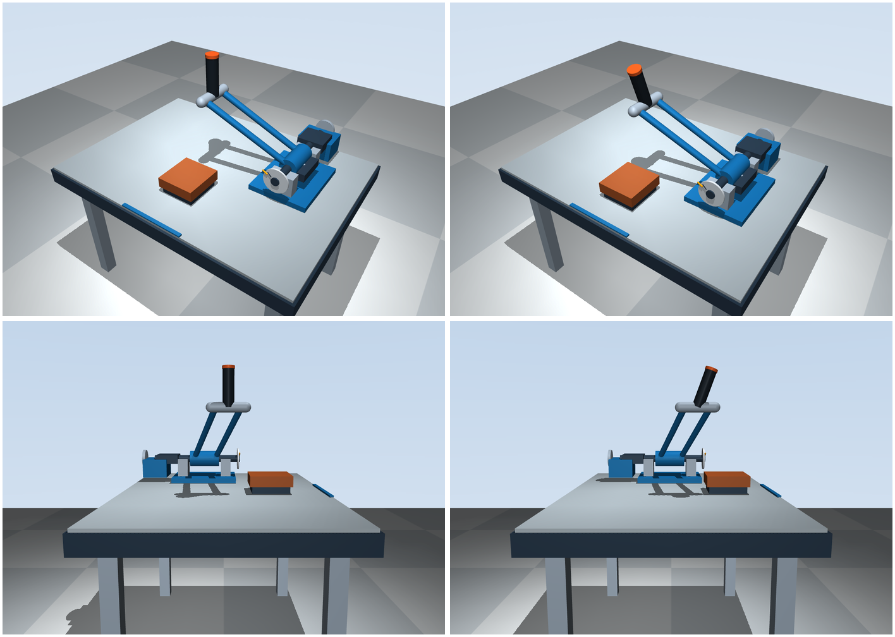

# 以肘垫和握持点为基准的前端布局（2026-11-08）

## 用户如何使用

用户坐在负 Y 桌边，身体大致位于 X=0 中线（可把 `(0,-0.65)` m 理解为示意坐位，不是人体尺寸）。蓝色桌边短条、橙色肘垫和握把中心均位于 X=0。

先把肘放在肘垫中心 `(0,-0.24,0.10) m`，其顶面 Z=0.123 m。手从该处向前约 0.10 m、向上约 0.362 m，到达握持中心 `(0,-0.14,0.485175) m`。前臂示意线始终在 X=0 的前后竖直平面内，不必向右伸到主轴处。肘垫顶面到握持点的直线跨度约 0.376 m；这是本次布局选用的示意值，不是成人平均尺寸或舒适性结论。

“手柄面向用户”解释为实际改变握把轴线，而非对圆柱绕自身转动：握把上端向负 Y 用户侧倾斜 20°，轴向为 `(0,-sin20°,cos20°)`。手握圆柱中段，上端更靠近用户。圆柱没有唯一正面，是否还需要横握、不同倾角或自由转动握把，仍需真实机械方案和使用者确认。

## 前端先定、后部适配

先固定上述肘垫、握持点和 20° 倾角，再通过握把下端与双杆横梁相接的约束反求主轴位置：

```text
grip_axis = (0, -sin20°, cos20°)
local_grip_center = (-0.34,-0.12,0.25) + 0.08 * grip_axis
world_grip_center = axis_origin + local_grip_center
```

据此主轴设为 `(0.34,0.007361611,0.16) m`。轴、轴承座、底座、传动罩和制动外壳整体向用户前移约 0.092638 m；仍在握持点的右后侧。没有添加保姿执行器或可动腕关节。

两根杆的端点偏置、长度约 0.438748 m、侧视抬升角 36.33° 均保持不变。握把底面中心直接落在端横梁中心，未使用悬空模型。杆与后部的改变服从握持位置约束，未修改相机来制造对齐效果。

## 同零位、同相机对比

左列为提交 `fdff920`，右列为本版。上排相同斜俯视相机（125°/-35°）；下排相同前臂侧面相机（0°/-8°，用于看前后方向的握把倾斜）。全部 θ=0。



| 项目 | 修改前 | 修改后 |
| --- | --- | --- |
| 肘垫中心 / m | (0,-0.20,0.10) | (0,-0.24,0.10) |
| 握持中心 / m | (0,-0.02,0.49) | (0,-0.14,0.485175) |
| 主轴位置 / m | (0.34,0.10,0.16) | (0.34,0.007362,0.16) |
| 握把朝用户倾角 | 0° | 20° |
| 肘垫—握持点左右偏移 | 0 | 0 |
| 肘垫—握持点前后偏移 | 0.18 m | 0.10 m |
| 肘垫顶面—握持点高度差 | 0.367 m | 0.362175 m |
| 示意前臂偏离竖直角 | 约 26.1° | 约 15.4° |

没有靠大幅降下整个手柄解决距离问题：握持高度只降低约 4.8 mm，主要变化是握持点向用户移近 0.12 m、肘垫向用户移近 0.04 m、握把朝用户倾斜。人体姿态近似更接近肘部受托、前臂上举握住近处把手，而不是从肘垫去够后方机构。

[斜俯视](previews/operator/oblique.png)、[用户侧观察](previews/operator/user.png)、[前臂侧面](previews/operator/sagittal.png)、[俯视](previews/operator/top.png)。用户侧图仅为观察方位，未建立真实头部/眼位模型。

## 控制和验证

- 主运动仍为单个 +Y 水平轴；获胜侧下压仍是负 θ，`forward_sign=-1`，按键 1/2/0 含义不变，控制公式未改。
- 倾斜握把与摆臂刚性连接，运动中会共同转动。箭头仍按真实世界轴线与握把径向计算，并沿握把自身轴向定位。
- 新轨迹为 `p(θ)=(0.34,0.007361611,0.16)+Ry(θ)(-0.34,-0.147361611,0.325175410)`，握持中心在 `y=-0.14` 的竖直平面内运动。负 θ 下压仍单调降低高度；默认边界 θ=-0.25 rad 时高度约 0.3910 m。
- 零位、边界刻度径向按新握持点更新，控制零位 θ0=0 和 qb=0.25 rad 不变。
- 23 项测试通过，新增握把朝向、下端接横梁、肘垫/握持点中线及前后位置检查；原有线性阻力、被动性、方向切换、无输入漂移与圆弧检查继续通过。
- 实际查看器从斜俯视、前臂侧面、用户侧、俯视各运行 320 步下压/返回力矩，正常退出。图片由 MuJoCo Renderer 用同状态/同相机生成；未通过姿态动画驱动装置。
- 理想被动配平和显式惯量继续用于控制验证；未修改 `sim/control.py`、`sim/run.py`、默认相机或 `real/`。

尚未验证不同身高、座椅/桌面高度、手腕活动范围和整个行程的人体可达性；没有人体接触约束。20° 倾角及示意跨度应在实体可调样机上验证，不能据此宣称完成真实人体工学或配重设计。
