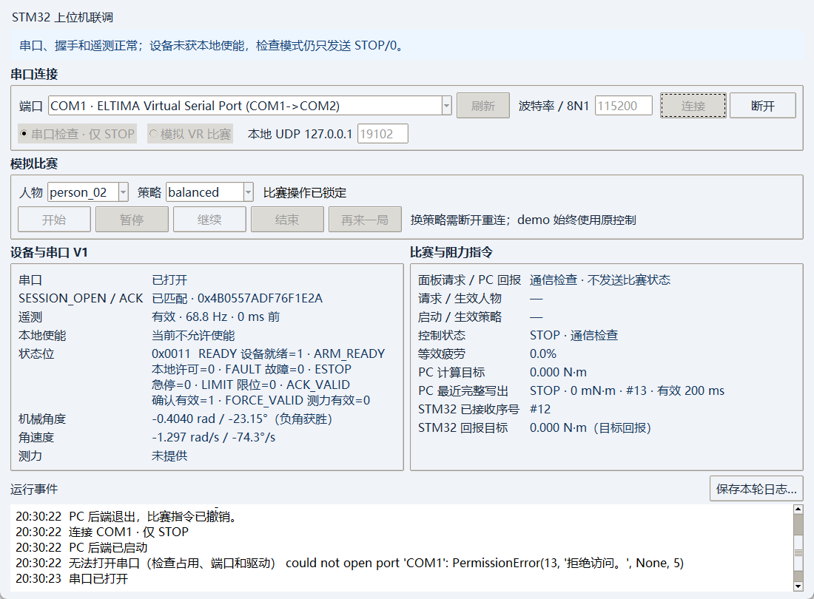
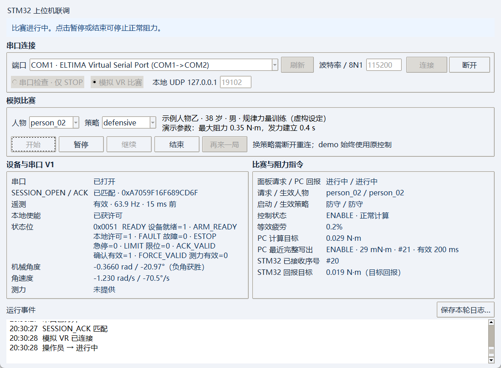
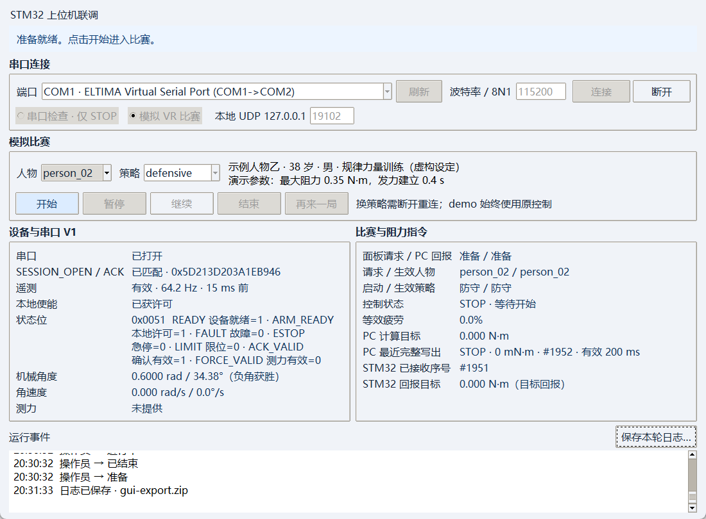

# STM32 联调面板 V0.1 · Windows 虚拟串口验收

2026-11-27，Windows，Python 3.11.5、Tk 8.6、pyserial 3.5。PC 打开 ELTIMA 虚拟串口 COM1，`sim.mock_stm32_serial` 在 COM2 运行；GUI 通过本地 UDP 19102 和实际 `real.run` 子进程收发。验证使用实际 Tk 控件和 Windows 保存对话框。模拟设备沿用原有软件机械；测试时在 COM2 一侧额外记录收到的 V1 指令，并用合法遥测帧模拟 FAULT。设备端授权由模拟器的 `--demo-arm` 明确开启。

## 面板操作

| 操作 | 实测结果 |
| --- | --- |
| 刷新端口，连接占用中的 COM1 或使用已占用的 UDP 19102 | 显示错误。释放 COM1 后按原设置完成连接 |
| 默认检查模式，模拟端未授权 | 串口打开、会话 ACK 匹配、遥测有效；`ARM_READY=0`，比赛按钮禁用 |
| 默认检查模式，模拟端已授权，外部 UDP 发送 12 条 `running` | COM2 解码到的 67 条制动指令均为 STOP/0，PC 无有效比赛状态 |
| 人物、策略与比赛按钮 | PC 确认 `person_02 + defensive` 和断开重连后的 `person_01 + rhythmic`。开始与继续能进入 ENABLE，暂停、结束后收到 STOP，回报目标为 0。再来一局后处于 waiting，疲劳为 0 |
| 模拟端报告 FAULT，发送有效零角度 | 仍显示 0 rad，暂停并发送 STOP。故障解除后保持暂停 |
| 最小化、卡住界面约 1.22 s | 最小化触发暂停并发送 STOP。界面卡住时心跳停发，PC 记录 `vr_timeout`；恢复后需要手动继续 |
| 退出并重启 COM2 模拟器 | 遥测失效、角度显示为 `—`，新会话握手后仍保持暂停 |
| 在比赛中终止 PC 子进程，再连接 | 面板撤销比赛并停止心跳，模拟器触发命令看门狗。重连后处于 waiting |
| 在比赛中关闭窗口 | 关闭流程末段在 COM2 解码到 5 条 STOP/0，面板自建 PC 子进程退出 |
| 保存日志 | Windows 保存对话框导出 ZIP，含 `pc.jsonl` 和 `gui.jsonl`，核对了比赛操作事件 |

比赛中的两条快照。PC 写出和 STM32 回报分别基于不同序号，表中的差值反映采样时点。

| 生效人物与策略 | PC 目标 | PC 写出 | STM32 确认 | STM32 回报 |
| --- | ---: | --- | --- | ---: |
| `person_02 + defensive` | 0.029 N·m | #21，29 mN·m | #20 | 0.019 N·m |
| `person_01 + rhythmic` | 0.041 N·m | #105，41 mN·m | #104 | 0.028 N·m |

## 截图

未获本地授权时，串口和遥测仍然可用。

模拟比赛中的人物、策略、目标与下位机回报。

再来一局后回到准备，日志区显示实际保存的 ZIP。

## 自动检查

- Windows Python 非 MuJoCo 回归共运行 112 项，111 项通过，1 项 Linux PTY 跳过。新增 5 项覆盖本机 UDP 源限制、仅 STOP 门控、通信恢复、完整写出与进程所有者退出。全量发现还包含受先前 Windows MuJoCo `WinError 1114` 影响的 8 项。
- 现有 `tests/serial/check_windows_v1.py` 在 COM1↔COM2 上通过 6 项，包括二进制握手、序号回绕、错误 CRC、旧序号与错误会话、看门狗撤销授权，以及新会话不继承旧目标。仅在软件虚拟端口对上使用该脚本。
- 本记录覆盖虚拟 COM 和软件模拟设备。实体板、固件保护、电气隔离与台架标定待硬件到位后验证。

[操作说明](stm32-debug-panel-v01.md)
