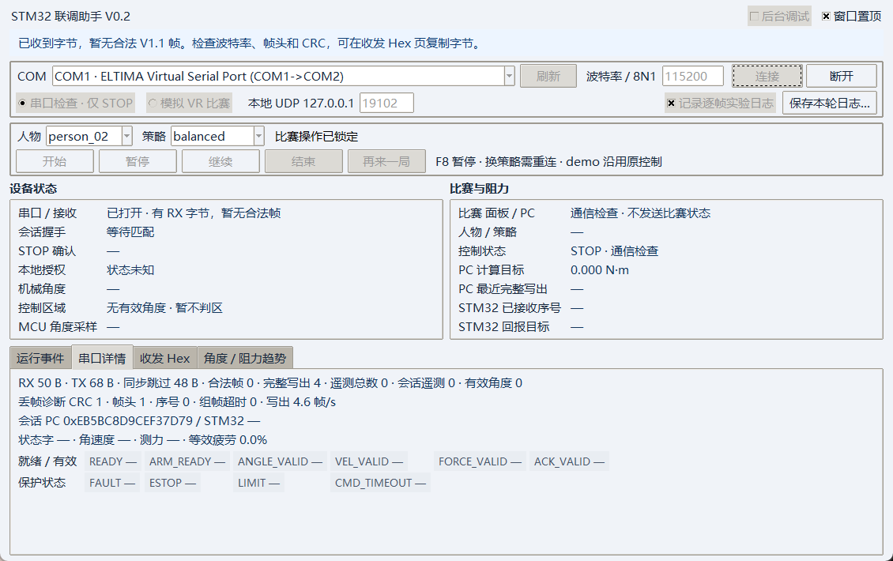
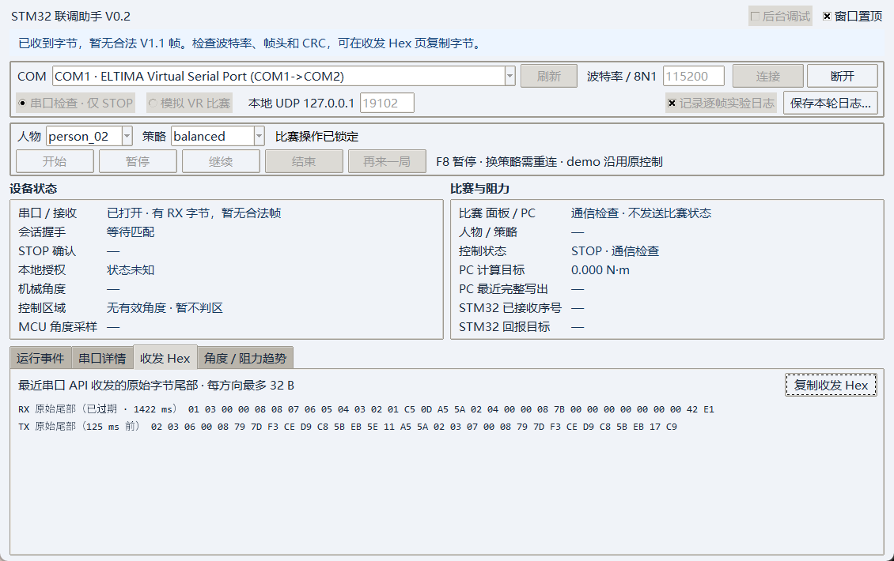
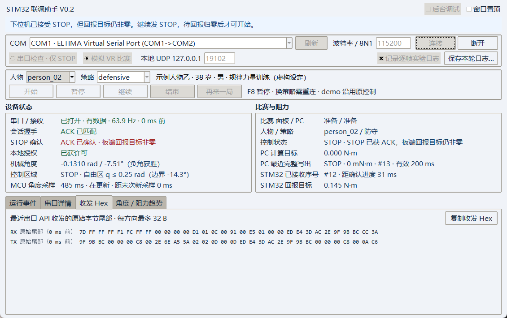
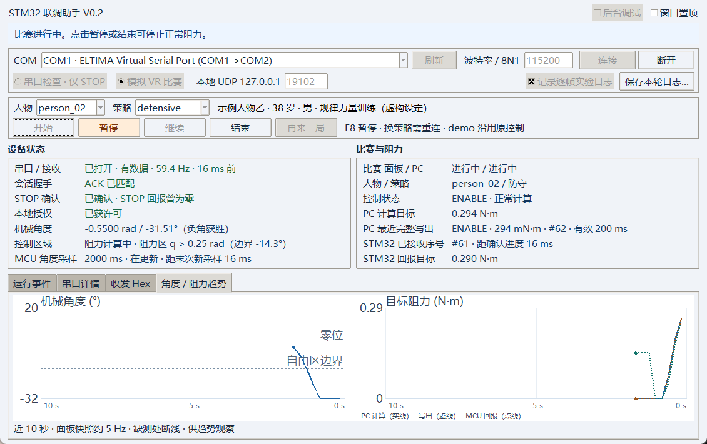

# STM32 联调助手 V0.2 · Windows 验收

2026-11-27，Windows、Python 3.11.5、Tk 8.6、pyserial 3.5。Tk 面板的 `real.run` 打开 ELTIMA COM1，软件模拟板使用 COM2，按 115200、8N1 实际收发。只在这对虚拟端口上模拟杂散字节、坏帧和不一致回报。窗口用 Windows 鼠标、键盘和原生对话框操作，截图为 1130 × 710 客户区，主要字段、图表和 Hex 复制均可见。

| 增加的检查 | 实测结果 |
| --- | --- |
| 从无字节恢复 | COM1 打开后 PC 发送 OPEN，RX 仍为 0。COM2 发 ASCII、旧版本帧和坏 CRC 后，观察到 RX 50 B、同步搜索跳过 48 B、合法帧 0、坏帧头 1、CRC 1。两个方向的 Hex 可复制 |
| 诊断遥测与握手 | 能先看到合法的未配对遥测，再看到 SESSION_ACK 和 STOP/0。未获准时开始按钮保持禁用；在同 COM 内换会话后，字节和错误统计保留 |
| 默认仅 STOP | 模拟板已授权时，外部 UDP 发 12 条 `running`。模拟设备解码的 34 条指令全部为 STOP/0 |
| STOP ACK 加零目标门控 | 模拟板先给匹配 STOP ACK 并回报 0.145 N·m。面板提示目标非零，“开始”禁用，线上仍为 STOP。收到匹配的零目标回报后，才允许手动开始 |
| 比赛与趋势 | 以 `person_02 + defensive` 进入阻力区，观察到非零写出与回报。开始、暂停、继续、结束、再来一局均已操作。V0.2 图表显示机械角度、零位、边界和三路目标的滚动趋势 |
| 聚焦与后台调试 | 确认窗口置顶切换、默认失焦暂停、F8 暂停。断开后在原生对话框确认后台调试，再连接，普通失焦时继续。最小化、COM2 退出时仍暂停。恢复后保持暂停，须手动继续 |
| 实验 ZIP 与离线分析 | 原生保存对话框实际导出。离线工具读出 192 条遥测和 98 条完整写出命令，丢记录 0，生成逐帧 CSV、PC 低频快照 CSV 与摘要。也用现有历史 JSONL 及 V0.2 STOP 节选验证入口 |

代表性比赛窗口的诊断快照中，实际遥测到达速率中位数为 **63.9 Hz**，串口 API 完整写出帧速率中位数为 **32.0 帧/s**。这些是本机软件虚拟 COM 实测值。协议仍采用 115200、遥测 100 Hz 和命令 50 Hz 的设计约定，未因本次测试修改。

## 截图

原始字节已到达，合法帧计数为零。

收发 Hex 显示最近各 32 字节，过期 RX 尾部有标记，仍可复制原始字节。

STOP ACK 匹配，但 MCU 回报 0.145 N·m，“开始”保持禁用。

软件模拟进入阻力区，图表分别显示角度、PC 计算、完整写出和 MCU 回报。

## 回归与范围

- Python 定向回归 **53 项通过，1 项 Linux PTY 在 Windows 跳过**。包括 V1.1 黄金帧、同步计数、部分写入、STOP 门控、ACK 与采样超时以及离线分析。
- 实际虚拟 COM 协议检查 **6 项通过**，包括同端口复位、序号回绕、CRC 和看门狗。
- C99 Windows 主机严格编译及 UBSan **8 组通过**，六条黄金帧一致。异常容量测试是主动构造的边界，长噪声及漏排空后仍能恢复。Windows Zig 环境缺少 ASan 运行库，本次未运行 ASan。
- 保留已有 V1.1 验收，本次未重复 Unity 或控制模型大规模测试。实体 STM32、实测传感器、电气独立保护和制动器台架仍待实际接板验证。

[操作说明](stm32-debug-panel-v02.md) · [实测 STOP 日志节选](../handoff/stm32_v11/example-v02-stop.jsonl) · [V1.1 历史验收](stm32-serial-v11-windows.md)
