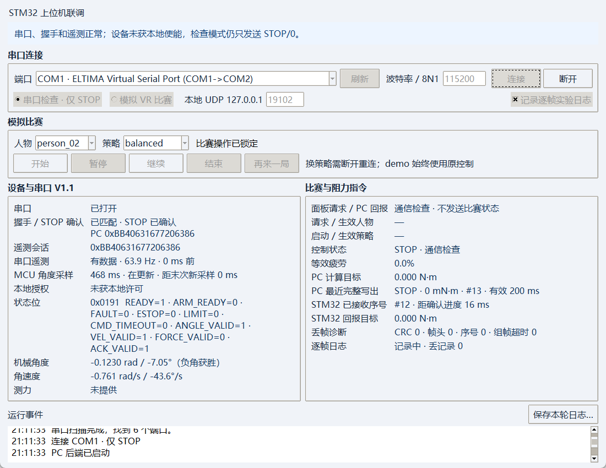
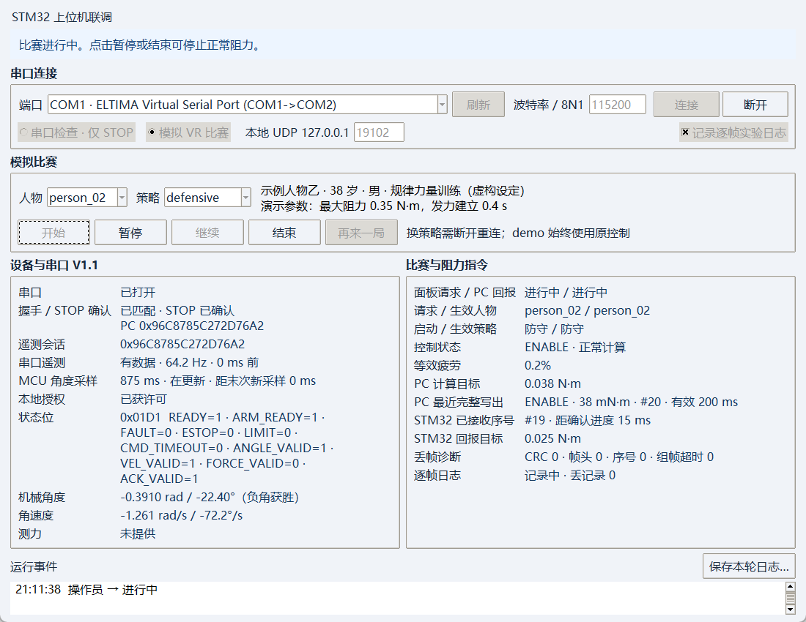
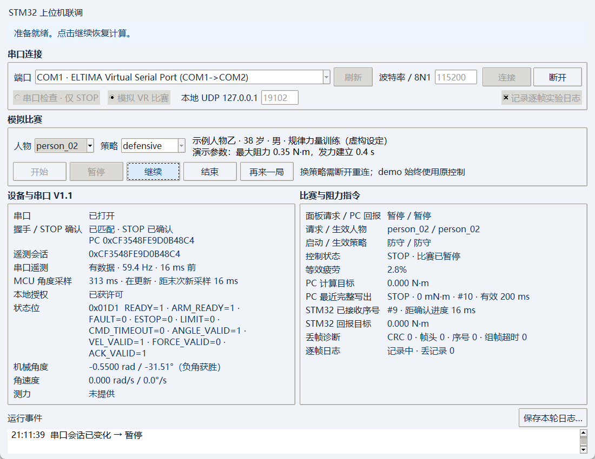
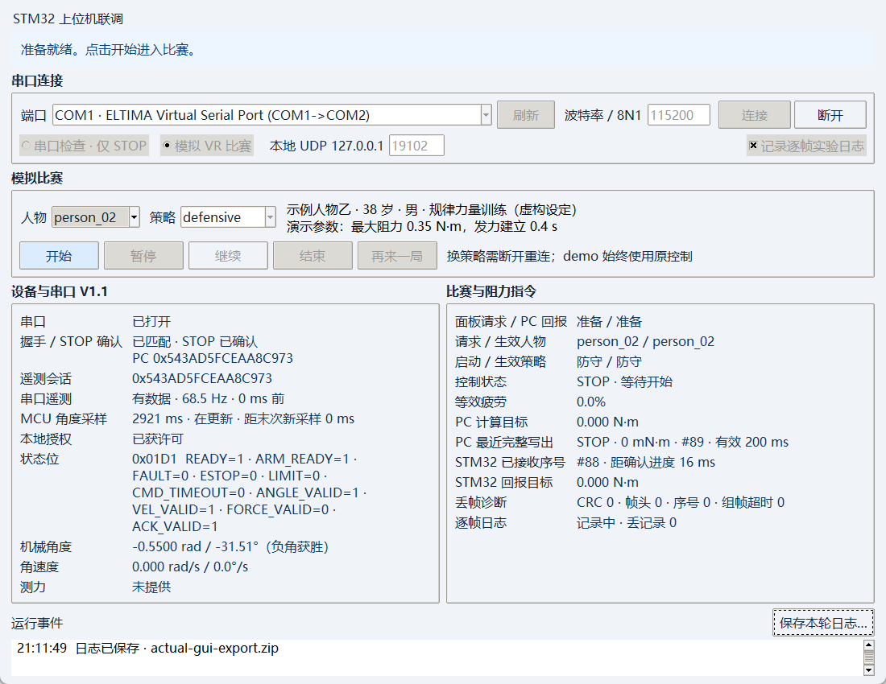

# STM32 V1.1 协议 · Windows 软件验收

2026-11-27，Windows，Python 3.11.5、Tk 8.6、pyserial 3.5。实际面板和 `real.run` 打开 ELTIMA COM1，模拟 STM32 持有配对 COM2，按 115200、8N1 传 V1.1 二进制帧。通过 Windows 鼠标操作面板并使用原生保存对话框。模拟器测试夹具在 COM2 侧解码实际指令，发合法遥测模拟故障、复位和数据停滞。

| 检查 | 实测 |
| --- | --- |
| 仅 STOP、模拟设备未授权 | V1.1 匹配会话、STOP 确认、MCU 时间推进。显示 `ARM_READY=0`，比赛按钮禁用 |
| 仅 STOP、模拟设备已授权 | 第三方 UDP 发 12 条 `running`；COM2 解码的 46 条命令全为 STOP/0 |
| 模拟比赛 | 选择 `person_02 + defensive`，逐项点过开始、暂停、继续、结束、再来一局。运行时确认 ENABLE 和非零目标，暂停/结束回报零。一次快照 PC 写出 #20＝38 mN·m，板端回报 #19＝25 mN·m，两条记录对应不同命令 |
| COM 不重开，MCU 单独复位 | 旧会话下一条序号为 40118，复位后观察到低序号、session=0。新会话确认 STOP，手动继续前在 COM2 解码的 14 条新会话命令全为 STOP/0 |
| 角度有效性 | 清 `ANGLE_VALID` 时正常阻力停止。帧序号增长但 MCU 样本时间冻结时也停止，线上的遥测仍显示有数据 |
| 速度与测力无效 | 对应读数缺失；速度缺失时使用现有对称阻力幅值，实验日志没有把占位速度或派生力矩写成实测值 |
| 遥测持续但 ACK 不推进 | PC 记录 `ack_timeout` 并重建会话。ACK 恢复后确认 STOP，并要求手动继续 |
| FAULT、COM 对端退出及重启 | 进入暂停，过期数据失效。对端恢复、握手和 STOP 确认之后，保持暂停直到操作员继续 |
| 日志 ZIP | 导出 `pc.jsonl`、`gui.jsonl`、`experiment.jsonl`。最终逐帧文件含 719 条遥测、363 条完整写出指令，队列丢记录 0。按会话和序号对照 COM2 解码到的 356 条指令，模式及目标全部相同 |

逐帧日志中的 PC 单调时间、MCU 采样时间分别来自两端，不能据此直接计算单程延迟。[实测日志节选](../handoff/stm32_v11/example-experiment.jsonl)

## 运行截图

未授权的设备完成握手/STOP 检查，仍然可显示有效角度。

`person_02 + defensive` 正在模拟比赛，显示写出的 ENABLE 和下位机回报。

同 COM 复位并再次确认 STOP 后，比赛保持暂停。顶部提示可手动继续。

保存实验日志后的实际界面。

## 独立检查

- **Python**：关联回归共 110 项，109 项通过，1 项 Linux PTY 在 Windows 跳过。覆盖黄金帧、V1 版本拒绝、分包粘包、时钟/序号回绕、ACK 新进度、刷新超时、串口写失败、日志队列上限、正式 UDP 的等待/继续和控制回归。
- **实际虚拟 COM**：`tests/serial/check_windows_v11.py` 6 项通过，覆盖未配对遥测、帧 CRC、首 STOP、命令回绕、同端口复位、高低遥测序号切换、看门狗清除会话及恢复。脚本会向软件模拟器发送非零 ENABLE，只在虚拟 COM 对使用。
- **便携 C**：Windows Zig 0.15.2，C99，`-Wall -Wextra -Wconversion -Wsign-conversion -pedantic -Werror` 编译运行，6 组测试通过。Python 和 C 均核对同一组 6 条黄金帧。
- 核对了正式 VR 的 V0.1 解析和暂停/继续条件。VR 消息字段不变，本次未重复运行 Unity。实体 STM32、实际板上驱动、传感器与电气保护待首次接板后验证。
