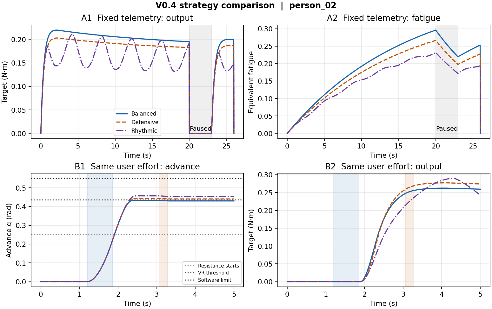

# V0.4 策略对照

2026-11-25 在 Windows、Python 3.11.5 运行。试验调用实际 PC 的 `BridgeState`，闭环再接入 P3.0 的 `SimulatedDevice`，两组都用固定 20 ms 步长和 200 ms VR 状态心跳。下表的疲劳和力矩是软件模型数据。



图中 A 组灰带为暂停。B 组蓝带为下压，棕带为回推。B1 从下到上的三条虚线依次为原阻力边界、VR 软件角度阈值和模拟器获胜侧限位。

## A. 相同人物、相同机械遥测

用 `person_02` 和 −0.4 rad、−0.2 rad/s。0 至 20 s 对抗，20 至 23 s 暂停，23 至 26 s 继续，26 s 进入 waiting。演示参数沿用任务建议。防守在 0.25 rad 至 25° 的推进区间从 0.60 线性升到 1，低负载处可见保留，高推进处恢复完整请求。节奏从 1 开始，以 4 s 平滑周期降到 0.65 再返回，20 s 内可看到五次变化。固定输入结果区分清楚，因此未为闭环结果另调策略曲线。

以下幅值单位均为 N·m。三种策略在 running 时共用静态目标 0.225 N·m。

| 时间（s） | 策略 | 系数 | 请求 | 疲劳后目标 | 实际下发 | 等效疲劳 |
|---:|---|---:|---:|---:|---:|---:|
| 2.00 | 均衡 | 1.000 | 0.225 | 0.220 | 0.219 | 0.048 |
| 2.00 | 防守 | 0.922 | 0.207 | 0.203 | 0.203 | 0.044 |
| 2.00 | 节奏 | 0.650 | 0.146 | 0.144 | 0.144 | 0.039 |
| 4.00 | 节奏 | 1.000 | 0.225 | 0.217 | 0.208 | 0.074 |
| 19.98 | 均衡 | 1.000 | 0.225 | 0.195 | 0.195 | 0.296 |
| 19.98 | 防守 | 0.922 | 0.207 | 0.183 | 0.183 | 0.266 |
| 19.98 | 节奏 | 1.000¹ | 0.225 | 0.202 | 0.192 | 0.232 |

¹ 19.98 s 的节奏系数为 0.999914，四舍五入显示为 1。节奏此时的疲劳后目标较高，但发力建立仍在跟随上升中的请求。

暂停首个采样下发为 0，有效对抗时间保持 19.98 s。暂停末疲劳分别降至 0.220、0.198、0.172。23 s 继续时保留相位并从零重新缓升。26 s 的 waiting 把疲劳、有效时间和目标幅值归零。

防守角度对照依次取 −0.25、−0.27、−0.40、−0.4363 rad。第 2 s 的系数约为 0.600、0.643、0.922、1.000，请求分别为 0、0.019、0.207、0.279 N·m。边界上的 0 仍来自原控制。

同用防守与 −0.4 rad、−0.2 rad/s，第 2 s 三个人物的系数同为 0.922。person_01、person_02、person_03 的原静态目标依次为 0.150、0.225、0.270 N·m，实际下发为 0.133、0.203、0.227 N·m。人物差异仍随各自原参数变化。

均衡默认参数重跑 [P3.0 比较](2026-11-25-p3-pc-input.md)，3,008 条记录的 CSV 与 V0.3 已记录散列一致，SHA-256 为 `2710d225beba810561406bb547ce2250e8e1c690971638b791aa475423b40797`。另在本试验的 1,301 个固定遥测时间点逐点验证，三种启动策略下 `demo` 的请求、下发、有符号制动力矩、功率和疲劳一致。

## B. 相同人物、相同模拟用户施力

从零位开始，所有策略接收完全相同的序列 `release:1.2,down:0.66,release:1.2,back:0.22,release:1.72`，下压／回推幅值为 0.065 N·m，其他时段施力为零。前置 1.2 s 让节奏策略在推进时进入较低占比区。在相同序列下，0.045 N·m 时最大推进为 0.360–0.374 rad，都未达软件阈值。0.09 N·m 时节奏已触限位，0.12 N·m 时三者都碰到限位，因此选 0.065 N·m。三种策略连续留在阻力区约 3.08 s。

| 策略 | 峰值推进 q（rad） | 首达 25°（s） | 最大下发（N·m） | 峰值疲劳 | 最负制动功率（W） | 触限位 |
|---|---:|---:|---:|---:|---:|---|
| 均衡 | 0.4327 | 未达到 | 0.2625 | 0.0840 | −0.0241 | 否 |
| 防守 | 0.4430 | 2.34 | 0.2773 | 0.0882 | −0.0232 | 否 |
| 节奏 | 0.4570 | 2.30 | 0.2899 | 0.0826 | −0.0195 | 否 |

角度 `theta` 向获胜侧为负，图 B1 用 `q=-theta` 表示推进量。角速度都经历了负值下压和正值回推，最负速度约 −0.623 rad/s，回推的最大正速度依次为 0.0129、0.0123、0.0147 rad/s。所有步的控制力矩及模拟制动功率未出现正功。回推来自模拟用户。阈值时间仅代表第一次跨过原 VR 角度线，实际比赛结算还需要 VR 的保持时间和状态判断。

相同施力下，节奏和防守早期阻力占比较低，允许推进得更远，后来因此进入更高的静态阻力区。闭环峰值下发高于均衡，是角度轨迹不同所致。比较策略本身的请求和疲劳用 A 组相同遥测的数据。

## 复现

```powershell
.\.venv\Scripts\python.exe tests/characters/v04_compare.py --output "$env:TEMP/strategy-comparison.csv"
```

两次运行生成的 [943 行 CSV 数据](2026-11-25-v04-strategy-comparison.csv) 相同。CSV 包含每 100 ms 的下采样、角度探针和人物探针。报告峰值与首达时间使用完整 20 ms 数据。需要重绘图时，用已安装 matplotlib 的 Python 并附加 `--plot strategy-comparison.png`。正式主场景复验独立记录。
