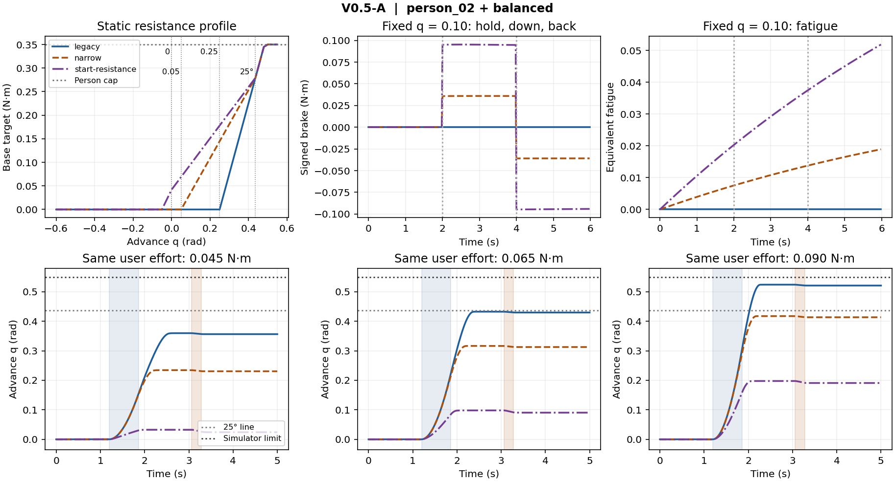

# V0.5-A 阻力生效区域对照

2026-11-25 在 Windows 使用实际 `BridgeState` 和 P3.0 的 `SimulatedDevice` 验证。三组均为 person_02 和 balanced，控制步长 20 ms，VR 状态心跳间隔 200 ms。机械推进取 `q=-θ`，所以表中的正 q 表示下压推进。三个候选仅调整静态角度到目标的映射。



图上排显示静态目标、相同角度下的有符号制动和疲劳。下排分别显示三个施力幅值的推进轨迹，蓝色底带为下压，棕色底带为回推。下排虚线为 25° 机械判定线和 +0.55 rad 推进侧模拟限位。

## A. 固定输入

原自由区为 0.25 rad，小自由区为 0.05 rad。零位起步曲线在 q=0 的静态目标为 0.04192 N·m，在 −0.05 rad 处连续退回 0。三条曲线在 25° 的目标都是 0.27950 N·m，从该角起按原曲线继续增加并受 person_02 的 0.350 N·m 上限约束。这组数据沿用任务书演示参数。

| 推进 q（rad） | 原自由区（N·m） | 小自由区（N·m） | 零位起步（N·m） |
|---:|---:|---:|---:|
| −0.025 | 0 | 0 | 0.02096 |
| 0 | 0 | 0 | 0.04192 |
| 0.05 | 0 | 0 | 0.06915 |
| 0.10 | 0 | 0.03617 | 0.09637 |
| 0.25 | 0 | 0.14469 | 0.17804 |
| 0.40 | 0.22500 | 0.25321 | 0.25972 |
| 0.43633 | 0.27950 | 0.27950 | 0.27950 |
| 0.50 | 0.35000 | 0.35000 | 0.35000 |

固定 q 的预设遥测依次为静止 2 s、角速度 −0.2 rad/s 持续 2 s、+0.2 rad/s 回推 2 s。固定角度与非零角速度组合用于隔离控制变量。下表是 q=0.10 rad 时各阶段末的结果。

| 候选 | 1.98 s 下发幅值 | 1.98 s 静止转矩 | 3.98 s 下压制动 | 5.98 s 回推制动 | 5.98 s 疲劳 |
|---|---:|---:|---:|---:|---:|
| 原自由区 | 0 | 0 | 0 | 0 | 0 |
| 小自由区 | 0.03582 N·m | 0 | +0.03595 N·m | −0.03587 N·m | 0.01892 |
| 零位起步 | 0.09498 N·m | 0 | +0.09476 N·m | −0.09412 N·m | 0.05185 |

在 q=0 的静止段末，零位起步方案已下发 0.04149 N·m 幅值，实际模拟转矩和功率均为 0，模型疲劳约 0.00867。这符合模型按请求量估算负荷的规则。回推时制动符号随速度翻转，零位方案在相同 q=0 的回推中仍有约 0.04151 N·m 的阻碍。小自由区方案回到 q≤0.05 时目标已为 0。该对照体现近零位回推的区别，尚无静态抗转矩实测。

## B. 相同模拟用户施力

每次从零位开始，复用 V0.4 施力序列 `release:1.2,down:0.66,release:1.2,back:0.22,release:1.72`。预设 0.045、0.065 和 0.090 N·m 三挡。下压和回推使用同档幅值，松手时为 0。累计制动耗能按每 20 ms 最后一个积分子步的功率乘以 20 ms 累加估算。

| 施力幅值（N·m） | 候选 | 首次下发 q（rad） | 峰值 q（rad） | 首跨 25°（s） | 最大下发（N·m） | 耗能（mJ） | 峰值疲劳 | 回推退让（mrad） |
|---:|---|---:|---:|---:|---:|---:|---:|---:|
| 0.045 | 原自由区 | 0.2560 | 0.3599 | 未达 | 0.1570 | 2.34 | 0.0456 | 3.11 |
| 0.045 | 小自由区 | 0.0546 | 0.2345 | 未达 | 0.1289 | 4.10 | 0.0423 | 3.50 |
| 0.045 | 零位起步 | 0.0000 | 0.0325 | 未达 | 0.0588 | 1.59 | 0.0244 | 6.65 |
| 0.065 | 原自由区 | 0.2590 | 0.4327 | 未达 | 0.2625 | 6.30 | 0.0840 | 2.70 |
| 0.065 | 小自由区 | 0.0501 | 0.3166 | 未达 | 0.1864 | 8.78 | 0.0630 | 3.62 |
| 0.065 | 零位起步 | 0.0000 | 0.0980 | 未达 | 0.0930 | 5.31 | 0.0366 | 6.64 |
| 0.090 | 原自由区 | 0.2582 | 0.5242 | 2.04 | 0.3378 | 14.10 | 0.1157 | 2.91 |
| 0.090 | 小自由区 | 0.0527 | 0.4176 | 未达 | 0.2563 | 17.05 | 0.0895 | 3.73 |
| 0.090 | 零位起步 | 0.0000 | 0.1976 | 未达 | 0.1449 | 12.53 | 0.0555 | 6.24 |

九次运行均未触模拟限位。全过程采样的制动功率均不大于 0，最负值约为 −0.0541 W。表中首次下发是控制目标幅值首个正样本，零位起步在静止段第 0.02 s 即建立目标。首跨角度线只记录软仿轨迹，实际结算还取决于 VR 的保持时间和状态。

回推退让为 3.06 至 3.28 s 的 q 净减量。例如 0.065 N·m 时，原自由区、小自由区、零位起步分别从 0.43266、0.31659、0.09800 rad 退至 0.42996、0.31297、0.09136 rad。零位起步在这段退让较多，但它从明显更小的角度开始。三组都没有回到零点。近零位同角度下的回推阻碍应参考 A 组的固定遥测。

固定遥测下，较早介入的两个候选在小角度累积较高的疲劳。闭环中它们的峰值疲劳反而较低，原因是相同施力下到达的角度和后续目标较小。小自由区的耗能在三挡都高于原曲线，说明制动介入前移后，峰值目标下降仍可伴随更多能量耗散。

## 候选建议

建议先用 **小自由区** 进入下一阶段软件验证，并保留原曲线作对照。它把下发起点从约 0.26 rad 提前至约 0.05 rad，保留零位附近的无额外阻力区。在 0.09 N·m 档它能推进到 0.4176 rad，离现有角度线约 1.1°，同时当前脉冲仍不足以跨线。后续可用更宽的施力与持续时间组合验证推进空间，并专测跨越 0.05 rad 后的回推和松手。

零位起步可以独立保留为早期抵抗对照。当前设置下，0.045 N·m 的脉冲只推进约 0.0325 rad，近零位回推也会受到制动。若继续评估该候选，优先试轻触、小幅往返和减小零位目标，再决定其是否适合台架。以上建议针对软件轨迹。实体初始抗转矩、手感及安全条件仍待独立确认。

## 复现

```powershell
.\.venv\Scripts\python.exe tests/characters/v05a_compare.py --output "$env:TEMP/arm-v05a-comparison.csv"
```

[实验 CSV](2026-11-25-v05a-resistance-comparison.csv) 包含 1,074 行数据。静态组保留曲线连接点，固定遥测每 0.5 s 取样并保留速度切换边界，闭环每 0.1 s 取样并保留回推起止点。报告与脚本标准输出的峰值、耗能、回推和跨线数据使用完整 20 ms 记录。闭环的角度、速度与指令对应步首，实际模拟制动、功率和累计能量对应步末。两次生成 CSV 的 SHA-256 均为 `05afcad213bca90f595da3ae73c3e1045f9ae42f0adcee458e33476c8b3dcfec`。如需重绘图，使用装有 matplotlib 的 Python 追加 `--plot resistance-comparison.png`。
