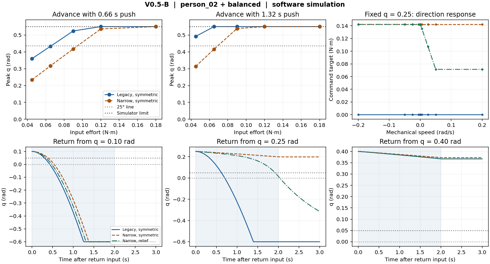

# V0.5-B 小自由区推进与同起点回推对照

2026-11-25 在 Windows 运行。使用 `person_02 + balanced`、实际 `BridgeState` 和现有 `SimulatedDevice`。控制步长为 20 ms，VR 状态心跳为 200 ms。推进量 q = −θ，正向推进对应机械速度为负。



上排前两图显示固定时长的峰值推进，虚线为 25° 软件判定角线和模拟推进限位。右图为固定 q 的方向探针。下排时间从回推施力开始计，蓝底为回推输入，接下来 1 秒的用户施力为 0。

## A. 从零位推进

全部试验采用原 V0.5-A 序列 `release:1.2,down:0.66,release:1.2,back:0.22,release:1.72`，长试验只把下压延长至 1.32 s。每个幅值下的下压和回推同幅反向。下表列出预先选定的全部组合。首跨时间从序列开始计，保持以连续超过或达到 25° 的首末两个采样时刻之差估算。0.35 秒是软件轨迹判据，正式 VR 还有独立的比赛状态逻辑。

| 下压时长（s） | 施力（N·m） | 曲线 | 峰值 q（rad） | 首跨 25°（s） | 最长保持（s） | 触限 | 峰值目标（N·m） | 耗能（mJ） | 峰值疲劳 |
|---:|---:|---|---:|---:|---:|---|---:|---:|---:|
| 0.66 | 0.045 | 原自由区 | 0.3599 | — | 0 | 否 | 0.157 | 2.34 | 0.046 |
| 0.66 | 0.045 | 小自由区 | 0.2345 | — | 0 | 否 | 0.129 | 4.10 | 0.042 |
| 0.66 | 0.065 | 原自由区 | 0.4327 | — | 0 | 否 | 0.262 | 6.30 | 0.084 |
| 0.66 | 0.065 | 小自由区 | 0.3166 | — | 0 | 否 | 0.186 | 8.78 | 0.063 |
| 0.66 | 0.090 | 原自由区 | 0.5242 | 2.04 | 2.96 | 否 | 0.338 | 14.10 | 0.116 |
| 0.66 | 0.090 | 小自由区 | 0.4176 | — | 0 | 否 | 0.256 | 17.05 | 0.090 |
| 0.66 | 0.120 | 原自由区 | 0.5500 | 1.90 | 3.10 | 是 | 0.338 | 13.22 | 0.120 |
| 0.66 | 0.120 | 小自由区 | 0.5362 | 1.92 | 3.08 | 否 | 0.338 | 30.49 | 0.122 |
| 0.66 | 0.180 | 原自由区 | 0.5500 | 1.76 | 3.24 | 是 | 0.338 | 10.87 | 0.124 |
| 0.66 | 0.180 | 小自由区 | 0.5500 | 1.78 | 3.22 | 是 | 0.338 | 26.21 | 0.126 |
| 1.32 | 0.045 | 原自由区 | 0.4918 | 2.42 | 3.24 | 否 | 0.338 | 12.54 | 0.127 |
| 1.32 | 0.045 | 小自由区 | 0.3139 | — | 0 | 否 | 0.186 | 10.04 | 0.071 |
| 1.32 | 0.065 | 原自由区 | 0.5500 | 2.18 | 3.48 | 是 | 0.338 | 18.48 | 0.134 |
| 1.32 | 0.065 | 小自由区 | 0.4158 | — | 0 | 否 | 0.257 | 19.58 | 0.103 |
| 1.32 | 0.090 | 原自由区 | 0.5500 | 2.02 | 3.64 | 是 | 0.338 | 14.22 | 0.139 |
| 1.32 | 0.090 | 小自由区 | 0.5384 | 2.08 | 3.58 | 否 | 0.338 | 35.56 | 0.142 |
| 1.32 | 0.120 | 原自由区 | 0.5500 | 1.90 | 3.76 | 是 | 0.338 | 12.81 | 0.143 |
| 1.32 | 0.120 | 小自由区 | 0.5500 | 1.92 | 3.74 | 是 | 0.338 | 31.72 | 0.145 |
| 1.32 | 0.180 | 原自由区 | 0.5500 | 1.76 | 3.90 | 是 | 0.338 | 10.86 | 0.147 |
| 1.32 | 0.180 | 小自由区 | 0.5500 | 1.78 | 3.88 | 是 | 0.338 | 26.21 | 0.149 |

表中凡有跨线的组合都保持超过 0.35 秒。小自由区在 **0.12 N·m × 0.66 s** 和 **0.09 N·m × 1.32 s** 达到保持条件且未触限位。0.18 N·m 两种时长都触限位。耗能只累计模拟制动功率，止挡对速度的截断另属模拟限位行为。

## B. 同起点回推

每组由测试程序把关节初始位置设为 q = 0.10、0.25 或 0.40 rad，初速度都为零。先保持 2 秒零用户施力以建立目标，再用 **+0.065 N·m 回推 2 秒**，最后松手 1 秒。原自由区与小自由区在预处理结束时各自的目标与疲劳不同，这是曲线差异的一部分。小自由区开启减阻前后的预处理逐步相等。

下表的时间从回推开始计，最多观察 3 秒。退让量为第 2 秒结束时相对起点的 q 减少量。负 q 表示已经过零向对手侧运动。

| 初始 q（rad） | 方案 | 回推前目标（N·m） | 回推前疲劳 | 2 s 后 q（rad） | 退让量（rad） | 到 q≤0.05（s） | 到零（s） | 3 s 后 q（rad） |
|---:|---|---:|---:|---:|---:|---:|---:|---:|
| 0.10 | 原自由区 | 0 | 0 | −0.6000 | 0.7000 | 0.30 | 0.44 | −0.6000 |
| 0.10 | 小自由区 | 0.0358 | 0.00754 | −0.6000 | 0.7000 | 0.40 | 0.54 | −0.6000 |
| 0.10 | 小自由区减阻 | 0.0358 | 0.00754 | −0.6000 | 0.7000 | 0.36 | 0.48 | −0.6000 |
| 0.25 | 原自由区 | 0 | 0 | −0.6000 | 0.8500 | 0.64 | 0.72 | −0.6000 |
| 0.25 | 小自由区 | 0.1421 | 0.03071 | 0.1990 | 0.0510 | — | — | 0.1983 |
| 0.25 | 小自由区减阻 | 0.1421 | 0.03071 | 0.0163 | 0.2337 | 1.94 | 2.04 | −0.3145 |
| 0.40 | 原自由区 | 0.2195 | 0.04839 | 0.3671 | 0.0329 | — | — | 0.3669 |
| 0.40 | 小自由区 | 0.2464 | 0.05472 | 0.3727 | 0.0273 | — | — | 0.3725 |
| 0.40 | 小自由区减阻 | 0.2464 | 0.05472 | 0.3673 | 0.0327 | — | — | 0.3670 |

回推期间的最大制动幅值、正向机械速度峰值及制动耗能如下。此处正机械速度即 q 减小。三个起点的所有曲线均未出现负机械速度。耗能估计取每个 20 ms 间隔最后一个子步的功率积分。

| 初始 q（rad） | 方案 | 最大实际模拟制动（N·m） | 回推和松手速度峰值（rad/s） | 回推耗能（mJ） | 松手额外耗能（mJ） |
|---:|---|---:|---:|---:|---:|
| 0.10 | 原自由区 | 0 | 0.9693 | 0 | 0 |
| 0.10 | 小自由区 | 0.0348 | 0.9585 | 0.991 | 0 |
| 0.10 | 小自由区减阻 | 0.0219 | 0.9659 | 0.516 | 0 |
| 0.25 | 原自由区 | 0 | 1.0331 | 0 | 0 |
| 0.25 | 小自由区 | 0.0640 | 0.0301 | 3.256 | 0.011 |
| 0.25 | 小自由区减阻 | 0.0630 | 0.4669 | 7.223 | 0 |
| 0.40 | 原自由区 | 0.0644 | 0.0189 | 2.116 | 0.002 |
| 0.40 | 小自由区 | 0.0645 | 0.0144 | 1.762 | 0.001 |
| 0.40 | 小自由区减阻 | 0.0644 | 0.0177 | 2.108 | 0.002 |

同一个 0.25 rad 起点证明小自由区会在回推中明显阻碍运动。减阻后 2 秒退让从 0.0510 到 0.2337 rad，但运动距离扩大，耗能随之增大。松手后过零并滑到 −0.3145 rad，表明去掉施力也可能继续运动。0.40 rad 起点的收益明显较小，三种方案都没有回到自由区。0.10 rad 下三组都会触到对手侧模拟限位，应比较达到小角度的时间，终点位移已受限位影响。

## C. 速度探针和往返

探针固定 q = 0.25 rad，重复同一静止预处理 2 秒，只在最后一拍换机械速度。减阻比例仅依据测得的运动方向，推进和静止时为 1，回推从 0 到 0.05 rad/s 线性降至 0.5。随后走同一疲劳和缓升模块。下表是小自由区的探针采样，符号为制动力矩方向。完整探针包含 ±0.001 rad/s 近零速和原自由区。

| 机械速度（rad/s） | 减阻比例 | 原制动（N·m） | 减阻制动（N·m） |
|---:|---:|---:|---:|
| −0.200 | 1.00 | +0.14209 | +0.14209 |
| −0.005 | 1.00 | +0.01421 | +0.01421 |
| 0 | 1.00 | 0 | 0 |
| +0.005 | 0.95 | −0.01421 | −0.01356 |
| +0.025 | 0.75 | −0.07104 | −0.05351 |
| +0.050 | 0.50 | −0.14209 | −0.07135 |
| +0.200 | 0.50 | −0.14209 | −0.07135 |

另外把小自由区减阻放进 0.065 N·m、0.66 秒的原往返序列。回推前的轨迹及峰值推进 0.31659 rad 完全相同，短回推 0.22 秒后的 q 为 0.31297（原）和 0.31229 rad（减阻），回推峰值速度从 0.01739 升到 0.02183 rad/s。全部试验的制动功率均非正，运动仍来自模拟用户或惯性。机械运动方向只能作为减阻条件，单靠速度无法判断用户意图。

建议小自由区和减阻都继续作为显式仿真选项，原自由区继续作为默认对照。先从多组中间角度补测慢回推与松手后的滑行，观察能否保留软退让而不过度滑向反侧，再讨论参数或台架验证。实际制动器、人体手感和硬件保护仍待独立验证。

## 复现

```powershell
.\.venv\Scripts\python.exe tests/characters/v05b_compare.py --output "$env:TEMP/arm-v05b-comparison.csv"
```

[实验 CSV](2026-11-25-v05b-direction-comparison.csv) 有 1,039 行数据，含 21 条推进轨迹、9 条同起点回推轨迹及 33 条固定角度探针的采样。轨迹每 0.20 秒取样并补收输入切换关键点。表格与脚本标准输出按完整 20 ms 数据计算。CSV 中角度、速度和 PC 指令属于步首，模拟器施加制动、功率和累计耗能属于步末。两次生成的 CSV SHA-256 均为 `41df96c2dab96f3367b637887c365687c8ea115699a75bcd6b34fb82057068c9`。有 matplotlib 时可附加 `--plot resistance-comparison.png` 重绘。
