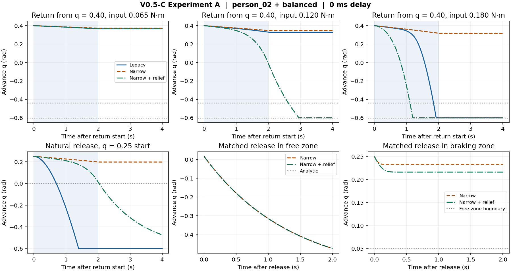

# V0.5-C A 组：回推与松手滑行

试验在 Windows 上以 V0.5-B 控制器和原 `SimulatedDevice` 运行。全组为 person_02 + balanced + 0 ms，调整项仅为已存在的自由区和回推减阻。以 q=−θ 表示推进，机械速度 ω>0 表示向 q 减小方向回推。



图上排比较 0.40 rad 起点的三个输入幅值。蓝底为有回推施力阶段，两条水平虚线分别为对手侧 25° 角线和模拟限位。下排区分自然释放、相同自由区释放初态和相同阻力区释放初态。

## A1 从相同起点回推

每次从 q=0.25 或 0.40 rad、ω=0 开始，预处理 2 秒，按预设幅值回推 2 秒，再令用户输入为零 2 秒。控制步长 20 ms，VR 状态心跳 200 ms，设备内部积分保持原样。两种小自由区方案在预处理到回推首个采样逐点相等。原自由区和小自由区保留各自不同的预处理目标与疲劳，作为曲线差异的一部分。0.065 N·m 组的前 1 秒松手与 V0.5-B 回跑逐步相等，代表轨迹也与旧记录数值一致。

下表列出全部 18 个组合。时间从回推开始计，“推”是回推施力中首次采到该角，“松”是松手首个或后续采样。刚好在 2.00 秒首次记录跨线时，上一积分间隔仍有施力。过零速度取首次 q≤0 时的实际采样，读数分辨到控制步长。位移是松手初始 q 减去当前 q，正值表示继续向对手侧运动。

| 起点 q（rad） | 输入（N·m） | 方案 | 到 q≤0.05（s） | 到零（s） | 过零 ω（rad/s） | 松手 q（rad） | 松手 ω（rad/s） | 松手后 1 s 位移（rad） | 松手后 2 s 位移（rad） |
|---:|---:|---|---|---|---:|---:|---:|---:|---:|
| 0.25 | 0.065 | 原自由区 | 0.64 推 | 0.72 推 | 0.666 | -0.6000 | 0.0000 | 0.0000 | 0.0000 |
| 0.25 | 0.065 | 小自由区 | — | — | — | 0.1990 | 0.0301 | 0.0007 | 0.0007 |
| 0.25 | 0.065 | 小自由区减阻 | 1.94 推 | 2.04 松 | 0.453 | 0.0163 | 0.4669 | 0.3309 | 0.4900 |
| 0.25 | 0.120 | 原自由区 | 0.46 推 | 0.52 推 | 0.950 | -0.6000 | 0.0000 | 0.0000 | 0.0000 |
| 0.25 | 0.120 | 小自由区 | 1.72 推 | 1.80 推 | 0.712 | -0.1866 | 1.0236 | 0.4134 | 0.4134 |
| 0.25 | 0.120 | 小自由区减阻 | 0.66 推 | 0.72 推 | 0.818 | -0.6000 | 0.0000 | 0.0000 | 0.0000 |
| 0.25 | 0.180 | 原自由区 | 0.38 推 | 0.42 推 | 1.191 | -0.6000 | 0.0000 | 0.0000 | 0.0000 |
| 0.25 | 0.180 | 小自由区 | 0.64 推 | 0.70 推 | 0.992 | -0.6000 | 0.0000 | 0.0000 | 0.0000 |
| 0.25 | 0.180 | 小自由区减阻 | 0.46 推 | 0.50 推 | 1.057 | -0.6000 | 0.0000 | 0.0000 | 0.0000 |
| 0.40 | 0.065 | 原自由区 | — | — | — | 0.3671 | 0.0189 | 0.0003 | 0.0003 |
| 0.40 | 0.065 | 小自由区 | — | — | — | 0.3727 | 0.0144 | 0.0001 | 0.0001 |
| 0.40 | 0.065 | 小自由区减阻 | — | — | — | 0.3673 | 0.0177 | 0.0002 | 0.0002 |
| 0.40 | 0.120 | 原自由区 | — | — | — | 0.3301 | 0.0499 | 0.0011 | 0.0011 |
| 0.40 | 0.120 | 小自由区 | — | — | — | 0.3477 | 0.0288 | 0.0003 | 0.0003 |
| 0.40 | 0.120 | 小自由区减阻 | 1.94 推 | 2.00 松 | 0.859 | -0.0092 | 0.8593 | 0.5908 | 0.5908 |
| 0.40 | 0.180 | 原自由区 | 1.54 推 | 1.58 推 | 1.314 | -0.6000 | 0.0000 | 0.0000 | 0.0000 |
| 0.40 | 0.180 | 小自由区 | — | — | — | 0.3179 | 0.0478 | 0.0006 | 0.0006 |
| 0.40 | 0.180 | 小自由区减阻 | 0.78 推 | 0.82 推 | 1.189 | -0.6000 | 0.0000 | 0.0000 | 0.0000 |

相同试验的角线与能量记录如下。最长保持按首次至末次连续满足对手侧角线的采样差估计。达到 0.35 秒只表示该离线轨迹满足角度保持条件。触限后速度由模拟限位截断，因此松手位移即使为零也不能推论其自由滑行程度。制动耗能为每 20 ms 末子步功率积分估计，限位的动能截断未计入。

| 起点 q（rad） | 输入（N·m） | 方案 | 首次到反侧 25°（s） | 最长保持（s） | 达 0.35 s | 触反向限位（s） | 峰值 ω（rad/s） | 制动耗能（回推／松手，mJ） |
|---:|---:|---|---|---:|---|---|---:|---:|
| 0.25 | 0.065 | 原自由区 | 1.24 推 | 2.76 | 是 | 1.40 推 | 1.033 | 0.00 / 0.00 |
| 0.25 | 0.065 | 小自由区 | — | 0.00 | 否 | — | 0.030 | 3.26 / 0.01 |
| 0.25 | 0.065 | 小自由区减阻 | 3.70 松 | 0.30 | 否 | — | 0.467 | 7.22 / 0.00 |
| 0.25 | 0.120 | 原自由区 | 0.88 推 | 3.12 | 是 | 1.00 推 | 1.536 | 0.00 / 0.00 |
| 0.25 | 0.120 | 小自由区 | 2.28 松 | 1.72 | 是 | 2.48 松 | 1.024 | 14.30 / 0.00 |
| 0.25 | 0.120 | 小自由区减阻 | 1.12 推 | 2.88 | 是 | 1.24 推 | 1.487 | 7.68 / 0.00 |
| 0.25 | 0.180 | 原自由区 | 0.70 推 | 3.30 | 是 | 0.80 推 | 1.957 | 0.00 / 0.00 |
| 0.25 | 0.180 | 小自由区 | 1.02 推 | 2.98 | 是 | 1.10 推 | 1.844 | 15.36 / 0.00 |
| 0.25 | 0.180 | 小自由区减阻 | 0.82 推 | 3.18 | 是 | 0.90 推 | 1.893 | 7.93 / 0.00 |
| 0.40 | 0.065 | 原自由区 | — | 0.00 | 否 | — | 0.019 | 2.12 / 0.00 |
| 0.40 | 0.065 | 小自由区 | — | 0.00 | 否 | — | 0.014 | 1.76 / 0.00 |
| 0.40 | 0.065 | 小自由区减阻 | — | 0.00 | 否 | — | 0.018 | 2.11 / 0.00 |
| 0.40 | 0.120 | 原自由区 | — | 0.00 | 否 | — | 0.050 | 8.28 / 0.03 |
| 0.40 | 0.120 | 小自由区 | — | 0.00 | 否 | — | 0.029 | 6.23 / 0.00 |
| 0.40 | 0.120 | 小自由区减阻 | 2.62 松 | 1.38 | 是 | 2.96 松 | 0.859 | 22.21 / 0.00 |
| 0.40 | 0.180 | 原自由区 | 1.84 推 | 2.16 | 是 | 1.94 推 | 2.016 | 16.70 / 0.00 |
| 0.40 | 0.180 | 小自由区 | — | 0.00 | 否 | — | 0.048 | 14.65 / 0.01 |
| 0.40 | 0.180 | 小自由区减阻 | 1.12 推 | 2.88 | 是 | 1.20 推 | 1.956 | 23.01 / 0.00 |

在 q=0.40 rad、0.065 N·m 下，三案都未回到 0.05 rad。固定 q=0.40、静止预处理后用速度探针可解释。回推 ω=0.015 rad/s 时小自由区减阻系数仍为 0.85，原制动幅值约 0.07393 N·m，减阻后约 0.06298 N·m，已接近施力幅值。达到 ω=0.05 rad/s 才降到 0.5。同一起点施力增至 0.12 N·m 时，小自由区减阻在松手时已到 q≈−0.0092 rad、ω≈0.8593 rad/s，松手后 0.62 秒越过对手侧 25°，0.96 秒触模拟反向限位。对照的小自由区对称制动在松手时仍为 q≈0.3477 rad。

## A2 匹配释放状态

自由区组从表中的 q 和 ω 直接初始化，两种小自由区模式的初始发力值和疲劳都为零，用户输入始终为零。全组 2 秒内保持在自由区且未触限位。位置、速度、目标、疲劳和制动耗能逐步相等。这里可用无制动的黏性阻尼解析式独立校验。

```text
ω(t) = ω₀ exp(−bt/J)
q(t) = q₀ − ω₀(J/b)(1 − exp(−bt/J))
J = 0.05469492132716054 kg·m²
b = 0.04 N·m·s/rad
```

| 释放 q（rad） | 释放 ω（rad/s） | 1 s 后 q（rad） | 1 s 解析 q（rad） | 1 s 后 ω（rad/s） | 2 s 后 q（rad） |
|---:|---:|---:|---:|---:|---:|
| 0.05000000 | 0.10000000 | -0.020861 | -0.020930 | 0.048101 | -0.054946 |
| 0.05000000 | 0.47000000 | -0.283048 | -0.283371 | 0.226075 | -0.443248 |
| 0.02000000 | 0.30000000 | -0.192584 | -0.192790 | 0.144303 | -0.294839 |
| 0.00000000 | 0.10000000 | -0.070861 | -0.070930 | 0.048101 | -0.104946 |
| 0.00000000 | 0.47000000 | -0.333048 | -0.333371 | 0.226075 | -0.493248 |
| 0.01633876 | 0.46692223 | -0.314529 | -0.314849 | 0.224595 | -0.473679 |

末行复现 V0.5-B 的自然松手初态。两种模式都得到 1 秒滑行约 0.33087 rad，离解析 0.33119 rad 仅约 0.00032 rad，差异来自原离散积分。对称和减阻的自然回推结果之所以不同，关键是松手时进入的角度、速度以及是否仍在阻力区。一旦以相同状态进入自由区，现有方向系数即使数值不同也没有阻力可缩放。

另在阻力区做一次匹配释放。将 q=0.25 rad 静止预处理 2 秒，释放前最后一个静止采样的下发幅值与疲劳两模式均为 0.14206 N·m、0.03042。随后同时以 ω=+0.30 rad/s 初始化释放速度，保持用户输入为零。首个有速度的采样中，对称制动下发 0.14209 N·m，减阻下发 0.07135 N·m。2 秒后两者 q 分别为 0.23297、0.21606 rad，仍处于阻力区。此时控制确实能改变滑行；差异在进入自由区之前形成。

当前实验仅以模拟用户力矩归零来标注松手。实际速度仍可能非零，角度和速度无法独立判断用户是否已松手。narrow 可作为后续软件对照候选，relief 暂保留显式实验选项。实际惯量、阻尼、残余制动与机械限位需在台架测量，进一步研究近零位制动时需同时评估正常回推的代价。

## 复现和数据

在 PC 仓库运行。

```powershell
.\.venv\Scripts\python.exe tests/characters/v05c_coast.py --output "$env:TEMP/v05c-coast.csv"
```

需要重绘曲线时，用装有 matplotlib 的 Python 追加 `--plot coast.png`。[数据 CSV](2026-11-25-v05c-coast.csv) 含 865 行，通常每 0.20 秒采样，另保留状态切换、角线和限位事件及前一拍。位置、速度和命令列对应步首，实际模拟制动、功率与累计能量对应步末。表中峰值和保持时间使用完整 20 ms 记录。CSV 中的速度探针位于 q=0.40 rad，静止预处理 2 秒，最后一拍设定七种机械速度。所有试验的模拟制动功率始终不大于零。

两次运行的 CSV 一致，Windows 生成文件的 SHA-256 为 `0f34bf72801b4d526dd0960bfa6737f866d8b33df0ed442386deb413241c166a`。
