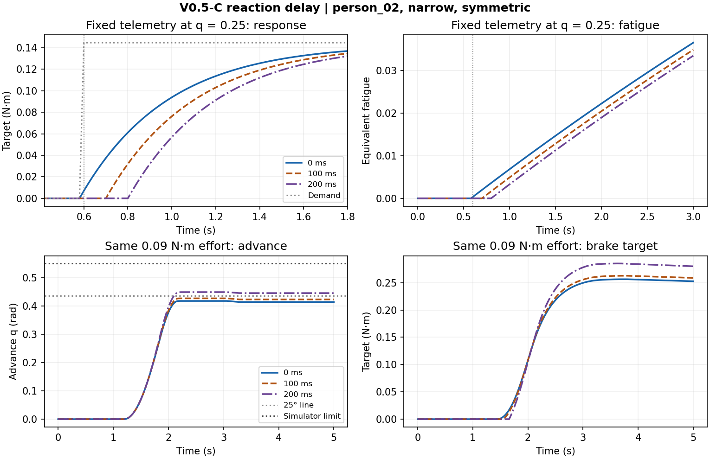

# V0.5-C 初次阻力需求延迟对照

2026-11-25 在 Windows 软件环境运行。全部工况采用 `person_02 + balanced + narrow + symmetric`，对照值为 0、100、200 ms。控制步长为 20 ms，VR 状态心跳为 200 ms，比赛状态或故障按试验时间表切换。下发阻力在开门后仍由原发力建立过程决定，本人物时间常数为 0.40 s。等效疲劳按门后有效请求量计算。



## 固定遥测与触发时刻

先让 `running` 保持在自由区 0.60 s，再固定在 q=0.25 或 0.40 rad 并给定推进速度 −0.20 rad/s，持续到 t=3.00 s。固定角度和非零速度配合使用，目的是隔离控制响应。两种角度的触发时刻均为 t=0.60 s。

| 设定延迟 | 门开启 | 首次正下发 | q=0.25 峰值下发 | q=0.25 结束疲劳 | q=0.40 峰值下发 | q=0.40 结束疲劳 |
|---:|---:|---:|---:|---:|---:|---:|
| 0 ms | 0.60 s | 0.60 s | 0.14233 N·m | 0.03659 | 0.24652 N·m | 0.06545 |
| 100 ms | 0.70 s | 0.72 s | 0.14232 N·m | 0.03493 | 0.24652 N·m | 0.06241 |
| 200 ms | 0.80 s | 0.82 s | 0.14228 N·m | 0.03353 | 0.24652 N·m | 0.05986 |

0 ms 沿用原控制，自由区的控制周期已建立更新时钟，所以遇到正需求的当拍就有正下发。100 和 200 ms 的第一拍有效请求只建立时钟，下一周期才出现正下发。对于任意事件时刻，实际量化受 20 ms 周期影响，表中特意使用与周期对齐的时刻。等待时间未计入发力建立，门关闭期间有效请求、目标和疲劳负载代理为零。较晚开门在相同固定遥测下缩短了负载时间，因此在 3 s 时的疲劳较小。

## 需求撤销与状态中断

另一组在 0.40 s 进入 q=0.25 rad，60 ms 后分别执行回到自由区、暂停或设备故障，0.60 s 恢复同样的正需求。100 和 200 ms 均在首次需求阶段保持零下发，两档都从 0.60 s 重新计时，开门及首个正下发分别复现上表的时刻。暂停和设备故障各自拍立即 STOP/0。0 ms 仍走原路径，回到自由区后再次进入的首个正下发为 0.60 s，暂停或故障恢复后为 0.62 s。回到自由区只是撤销需求的遥测输入，实际 PC 用角度和速度作判断。

## 相同用户施力的闭环

每组从软件零位开始，使用相同序列 `release:1.2,down:0.66,release:1.2,back:0.22,release:1.72`，下压和回推同幅反向。时间从序列开始计。最长保持是 25° 角度线上连续采样的首末时间差，正式场景另有比赛状态逻辑。耗能是每个 20 ms 区间末子步制动功率的估计积分，限位截断的速度变化另计。

| 施力（N·m） | 延迟 | 触发 / 开门 / 首次下发（s） | 峰值推进（rad） | 首跨 25° / 最长保持（s） | 触限 | 最大下发（N·m） | 制动耗能（mJ） | 峰值疲劳 |
|---:|---:|---|---:|---|---|---:|---:|---:|
| 0.065 | 0 ms | 1.50 / 1.50 / 1.50 | 0.31659 | — / 0 | 否 | 0.1864 | 8.78 | 0.06301 |
| 0.065 | 100 ms | 1.50 / 1.60 / 1.62 | 0.32306 | — / 0 | 否 | 0.1910 | 8.71 | 0.06445 |
| 0.065 | 200 ms | 1.50 / 1.70 / 1.72 | 0.33948 | — / 0 | 否 | 0.2025 | 8.41 | 0.06799 |
| 0.090 | 0 ms | 1.46 / 1.46 / 1.46 | 0.41762 | — / 0 | 否 | 0.2563 | 17.05 | 0.08950 |
| 0.090 | 100 ms | 1.46 / 1.56 / 1.58 | 0.42681 | — / 0 | 否 | 0.2627 | 16.96 | 0.09165 |
| 0.090 | 200 ms | 1.46 / 1.66 / 1.68 | 0.44887 | 2.12 / 2.88 | 否 | 0.2851 | 16.53 | 0.09931 |
| 0.120 | 0 ms | 1.42 / 1.42 / 1.42 | 0.53619 | 1.92 / 3.08 | 否 | 0.3376 | 30.49 | 0.12241 |
| 0.120 | 100 ms | 1.42 / 1.52 / 1.54 | 0.54629 | 1.92 / 3.08 | 否 | 0.3377 | 30.44 | 0.12232 |
| 0.120 | 200 ms | 1.42 / 1.62 / 1.64 | 0.55000 | 1.90 / 3.10 | 是 | 0.3377 | 25.85 | 0.12184 |

全部闭环的模拟制动功率始终非正。等待增加后，制动介入前已有更多推进，0.090 N·m 的 200 ms 工况因此跨越角度线，并保持 2.88 s。0.120 N·m 的 200 ms 工况则触及模拟限位。固定遥测中疲劳随等待增加而减少，但在 0.065 和 0.090 N·m 的闭环里，较晚制动产生了更大的推进和后续需求，峰值疲劳反而上升。建议保持 0 ms 作为软件主候选，100 ms 保留作灵敏度对照，200 ms 用于边界测试。实机响应时间和惯量、阻尼标定后再选参数。

## 复现

```powershell
.\.venv\Scripts\python.exe tests/characters/v05c_delay.py --output "$env:TEMP/arm-v05c-delay.csv"
```

[实验 CSV](2026-11-25-v05c-delay.csv) 含 931 行数据。每 100 ms 取样并保留状态、请求、门、正下发、角线及模拟限位的边界样本。表中指标按完整 20 ms 记录计算。两次生成 CSV 的 SHA-256 均为 `8a8a97f740f1c641fa1a06e7d684ed1055c2d1db2cdcb1d24a9edcbfc5f89022`。用装有 matplotlib 的 Python 附加 `--plot reaction-delay.png` 可重绘图。
