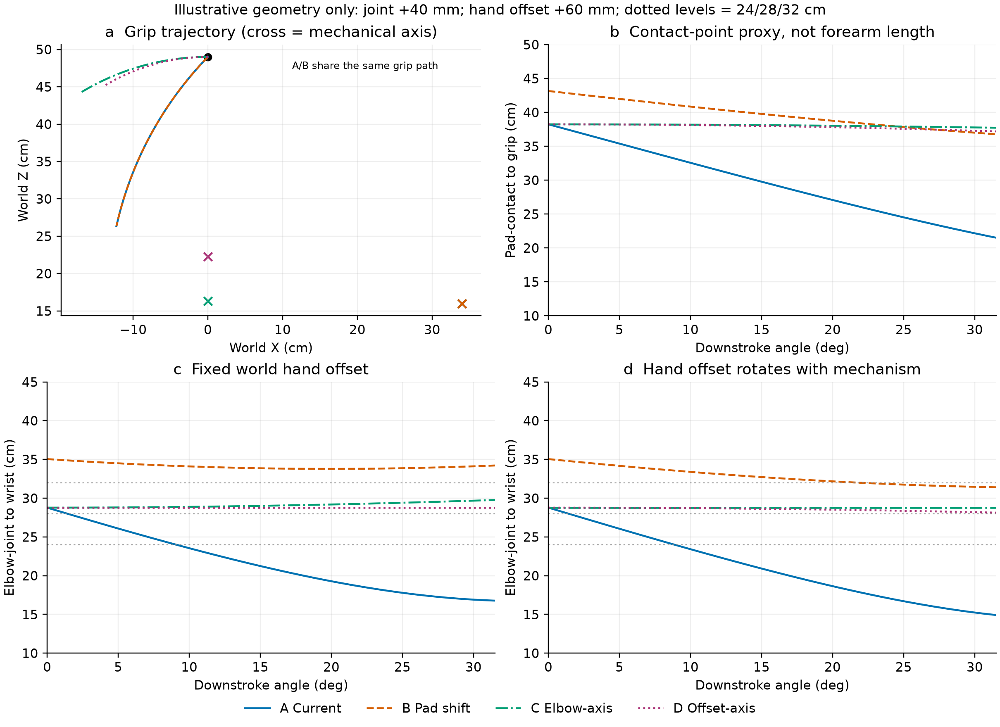
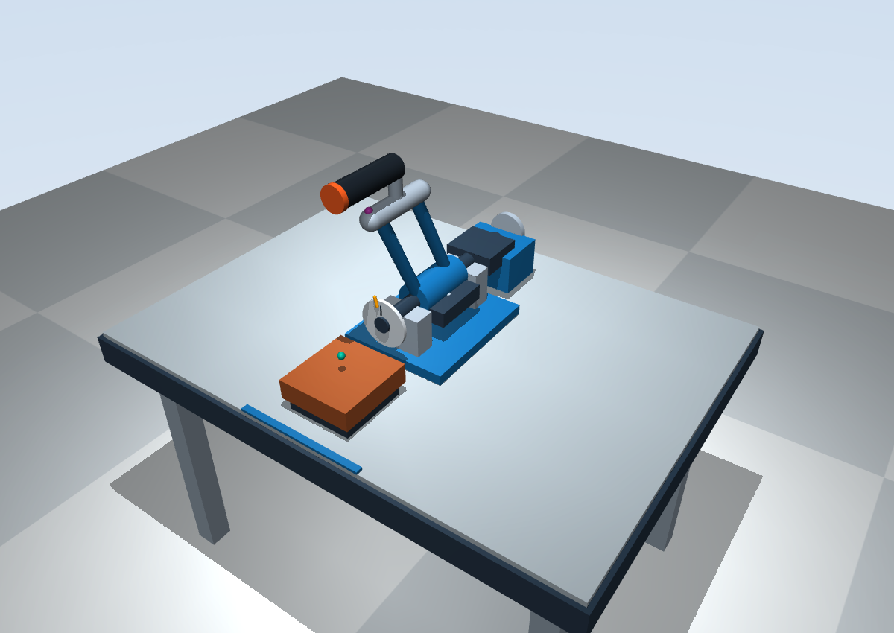
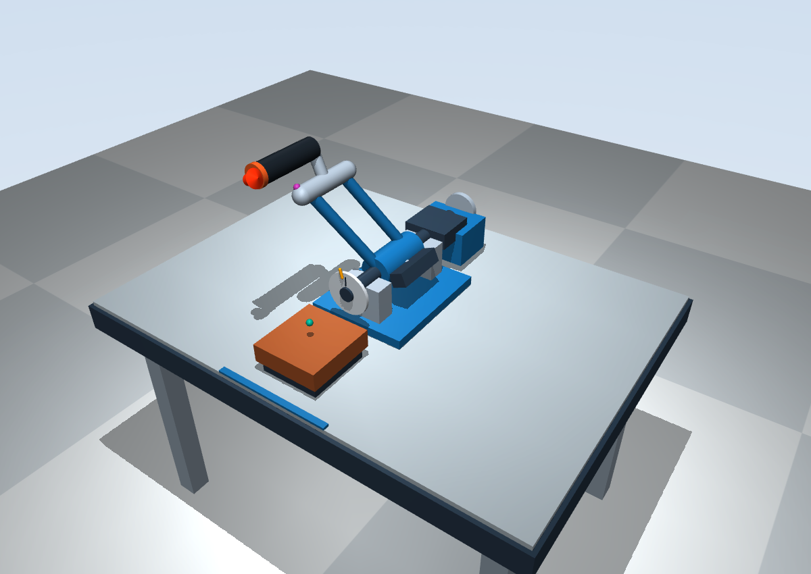

# 固定肘部与握持轨迹适配分析（2026-11-08）

## 结论与建议

推荐下一阶段优先验证 **C：输出主轴在 XZ 平面内对准实际肘关节中心投影**。它在本次示例中明显减少长度变化，仍可用单自由度和水平握把实现；不必先开发复杂连杆。

保留 `sim/arm.xml`（d994936）为默认基线 A，独立增加 `sim/candidates/elbow_axis.xml` 供观察。C 尚未用真实人体尺寸确认，且需要改变轴位和杆形，不能直接宣布为最终装置。若实际手部偏置更接近世界固定姿态，D 是另一个值得校准的方案。

## 四类点与两种手部假设

所有输入单位 m，角度 rad。用户沿负 Y 坐在桌前，主轴沿 +Y。

- **P：肘垫接触参考点**，取垫顶中心 `(0,-0.30,0.123)`，不是实际肘关节中心。
- **E：实际肘关节中心的示例**，名义取 P 上方 0.040 m，即 `(0,-0.30,0.163)`。真实关节中心的三维偏置需要测量。
- **G：握持中心**，取圆柱中点。四个方案统一零位 `G0=(0,-0.192638388534,0.49)`，避免通过更换初始握持点掩盖结果。
- **W：手腕中心示例**，不与 G 合并。名义手腕→握持向量取 `h0=(0,0,0.060)`。这不是人体测量值。

水平握把长轴不变，不等于整个手部姿态不变：围绕圆柱长轴的滚转仍可能发生。因此比较两种明确的简化：

1. **世界固定偏置**：`W(θ)=G(θ)-h0`，表示手部偏置在世界中不变。
2. **随机构滚转偏置**：`W(θ)=G(θ)-Ry(θ)h0`，表示偏置随刚体绕 Y 转动。圆柱轴向仍然是负 Y，此模型无需额外机械自由度，但不能据此声称真实手腕一定如此运动。

示例前臂长度 L=0.24/0.28/0.32 m 定义为 E 到 W，不是肘垫到握把。它们只作比较场景，不是人群分位数、正常范围或特定用户参数。所有布局使用相同参数；另用固定候选几何做敏感性检查，没有分别调人体参数来让方案通过。

## 为何现有右侧轴位造成变化

机械轴基准为 O，零位相对握持向量为 r，则：

```text
G(θ) = O + Ry(θ)r
```

在世界固定手部模型下，记 `d=O-E-h0`，则：

```text
|W-E|² = |r_perp|² + (d_y+r_y)² + |d_perp|² + 2 d_perp · [Ry(θ)r_perp]
```

`perp` 表示 XZ 分量。最后的点积随 θ 变化。对非零半径、连续非零转角区间，若要严格恒长，需要 `d_perp=0`，也就是腕部圆弧的圆心投影与 E 对齐。

随机构滚转模型中 `W=O+Ry(θ)(r-h0)`，对应恒长条件变为 `O_perp=E_perp`。

所以只改变杆长或零位角可以在有限区间内减小变化，却不能使两个不同圆心的连续圆弧严格相同；缩短行程也只能局部缓解。若必须保留右侧输出轴及原长摆臂轨迹，又要求肘固定、手固定及前臂恒长，简单刚体单轴通常无法同时满足。可考虑被动传动把制动器留在右侧、输出转轴移到适合的位置；若轴位完全不能移动，再讨论轨迹连杆，不在本轮开发。

## 四个候选，统一 θ=0 到 -0.55 rad

| 布局 | 主轴 O 的 X/Z | 肘部处理 | 其他变化 |
| --- | --- | --- | --- |
| A 当前 | 0.34 / 0.16 | 原肘垫 | 基线，无修改 |
| B 只移肘垫 | 0.34 / 0.16 | 垫与 E 整体右移 0.20 m | G 轨迹不变，初始出现 0.20 m 左右偏移 |
| C 肘轴对齐 | 0 / 0.163 | 原肘垫及名义 E | 保持 G0，重新生成杆长/零位连接 |
| D 固定手部偏置对齐 | 0 / 0.223 | 原肘垫及名义 E | O_perp=E_perp+h0_perp，保持 G0 |



图 a 是握持点的世界 XZ 轨迹，叉号为机械主轴位置；A/B 同轨迹。图 b 是 P→G 代理距离。图 c/d 才是两种手部模型下的 E→W 前臂距离；灰色虚线为三个示例前臂长度。所有线来自确定性几何计算，不是受试者样本，也没有统计误差条。

## 距离变化与动作方向

表中“变化”均为整个范围内最大值减最小值，不只比较两端点。

| 布局 | P→G 零位→末端 / cm | P→G 变化 / mm | E→W 变化：世界固定 h / mm | E→W 变化：随动 h / mm | 握持点下降 / cm |
| --- | --- | --- | --- | --- | --- |
| A | 38.238→21.510 | 167.280 | 120.013 | 138.607 | 22.638 |
| B | 43.153→36.770 | 63.822 | 12.643 | 36.372 | 22.638 |
| C | 38.238→37.730 | 5.078 | 9.885 | 约 0（数值误差） | 4.822 |
| D | 38.238→37.194 | 10.440 | 约 0（数值误差） | 6.437 | 3.938 |

B 对某一种手部假设确实明显改善，不能说只移动肘垫一定无效；但它让初始手臂向左斜伸、要求较长的示例前臂，而且对手部滚转假设更敏感。C/D 保留原初始握持点和中线，在人体模型间更稳定。

C/D 的运动更多是从上举零位向获胜侧侧倾，下降幅度较小；初始下降斜率为零，离开零位后高度下降。不能把角行程相同理解成垂直压下距离相同。真实获胜位置可能需要不同角行程，须另做尺寸和干涉核对，本轮未扩大限位。

## 示例前臂长度检验

以下是**世界固定 h** 模型在整个行程中 `max| |W-E|-L |`，单位 mm；不是临床容差或安全标准。

| 布局 | L=240 mm | L=280 mm | L=320 mm |
| --- | --- | --- | --- |
| A | 72.2 | 112.2 | 152.2 |
| B | 110.5 | 70.5 | 30.5 |
| C | 57.7 | 17.7 | 32.2 |
| D | 47.8 | 7.8 | 32.2 |

“变化小”和“适合某一实际长度”是两项条件。C 随动 h 模型的距离恒定在约 287.8 mm；D 固定 h 模型也是约 287.8 mm，不能因此认定适合所有人。真实 L 不同时，需要调整初始握持位置/半径、轴位或垫位置，不能改报人体长度来迁就机构。

## 假设敏感性

保持四个候选几何固定，分别改变 E 高于 P 的高度为 20/60 mm、E 左右偏移 ±20 mm、h_z 为 40/80 mm；每次只改一项，其余保持名义值。全结果在 `sensitivity.csv`。这不是随机采样或完整的人体参数覆盖。

在这些场景及两种手部模型中的最坏 E→W 变化：A 150.6 mm、B 48.1 mm、C 21.1 mm、D 14.2 mm。因此候选的改善不是只来自一个恰好的名义偏置，但残差仍可能超过具体用户允许的范围。C 的优先级来自轴对肘关节投影的直接几何关系；D 对已知固定手部偏置更合适，需实测手腕滚转决定。

## 机械筛查及候选 C

对每个简化模型在 101 个角度上调用 `mj_geomDistance`。只检查握把—双杆/肘垫/桌面，以及部分移动构件—底座/支座/护罩/肘垫/桌面；排除设计连接及轴承轴颈。碰撞响应仍禁用，所以这是离散几何筛查，不是碰撞仿真或实物安全认证。

| 布局 | 所筛运动件/固定件最小距离 | 所筛对中有无交叠 |
| --- | --- | --- |
| A | 0.61 mm | 无，但很小，需 CAD 核对 |
| B | 0.61 mm | 无，但很小 |
| C | 12.06 mm | 无 |
| D | 9.97 mm | 无 |

最小对均为前侧杆与前轴承座、θ=-0.55。C 的握把到两根杆、肘垫、桌面最小距离分别约 41.0/63.8/305.2/369.8 mm。未检查手指、人体、真实传动细节和制造公差。

C 模型仍 nq=1、nu=0，无 gravcomp；101 点握把轴向误差约 4.4e-16。为使输出轴与肘部投影对齐，它不再保留右侧长摆臂外形：杆变短、接近竖直，后部模块移到桌面中线。制动器未来可用被动传动另行布置。当前 XML 使用原显式惯量/理想被动配平，只作几何和控制观察，不代表新结构已完成质量辨识。

候选中的绿色小点为名义 E，紫色小点为随动 h 模型的 W，均是参考标记，不是实体关节。





候选已实际启动查看器并完成下压/返回；截图 θ≈-0.4006 时握持高度 0.4641 m，制动正力矩约 0.3013 N·m，轴向仍为负 Y。

## 复现及数据

```bash
cd /home/lyf/armwrestling
uv pip install --python .venv/bin/python -r sim/requirements-analysis.txt
.venv/bin/python -m sim.fit_analysis
.venv/bin/python -m sim.run --model sim/candidates/elbow_axis.xml
.venv/bin/python -m unittest discover -s sim -p 'test_*.py' -v
```

不带 `--model` 仍运行原 `sim/arm.xml`。生成器会重建候选 C 和 `docs/analysis/fit/` 的确定性结果。`paths.csv` 是 4×501 个几何状态；`summary.csv`、`sensitivity.csv`、`geometry.json` 保存统计量、场景及筛查结果；`metadata.json` 记录源模型 SHA256、软件版本与假设。图同时导出 PNG/PDF。

本轮共 30 项测试通过。新增测试核对解析轨迹与原模型/候选 MuJoCo 运动学一致，以及两种恒长条件；既有控制测试通过。主模型 XML、控制律和 `real/` 未变，仅入口增加可选 `--model`。

## 最终确认前需要测量

1. 肘垫接触点到实际肘关节旋转中心的三维偏置，以及肘部允许移动的范围。
2. 实际 E→W 前臂长度；W→G 向量、握持点在圆柱上的位置，以及下压时手部相对握把的滚转方式。
3. 零位用户坐姿、桌椅高度、手腕允许姿态和目标获胜角行程。
4. 机械组允许的输出轴位置、杆/握把连接尺寸、实际轴承与传动外廓、配重和惯量。

推荐保留 A 作为可复现基线，保留 C 作为下一阶段优先校准的适配候选；在以上尺寸未确认前，不直接用候选替换默认或宣称完成真实人体适配。
